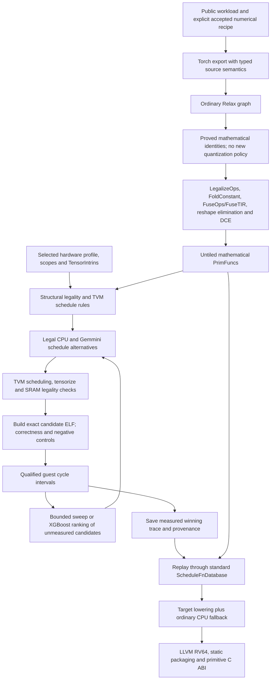

# Gemmini execution, numerical contracts and optimization readiness

This extends the frozen [TensorIR migration audit](TENSORIR.md). The old 51-op
audit describes explicit small contracts at source `19b96df8`; it does not
qualify every overload, an entire model, or performance. New EL4 diagnostics use
the public Merlin branch pinned at
[`0cc289de52a10bed256f32c90cfbb54a21b3c81f`](https://github.com/ucb-bar/merlin/tree/0cc289de52a10bed256f32c90cfbb54a21b3c81f/examples/gemmini/target).
Source receipts and all attempts live in `../tensorir-dev/el4-dse-v1` relative
to the TVM checkout. Historical receipts are retained, including failures.
Executable source is frozen at `99e55311e762a274a0e6c94fbb41308356b78eb8`.
The [qualification index](../../../tensorir-dev/el4-dse-v1/qualification-v1.json)
binds current captures, execution receipts, source files and validation logs.

## Where execution happens

**Rocket executes the program on both simulators.** Generated Rocket code issues
RoCC instructions for the Gemmini array and DMA. It also executes every CPU
quantization, packing, floating operation, loop and call. Spike is a functional
ISA/device model. The pinned Verilator binary executes Rocket and Gemmini RTL
with its selected magic-memory model. Neither is a FireSim deployment run.

"Gemmini function" is insufficient attribution: a TIR function can use DMA and
perform all its arithmetic on Rocket. Reports therefore retain the actual
`tvm_gemmini_compute`/DMA calls, CPU refusals and static `call_tir` site counts.
TVM shares identical functions: five source matmuls can become two functions
called five times. Static sites are not dynamic hardware command counts.

The old route constructs a tiled template early. The current route keeps the
mathematics until after normal graph optimization and uses real Schedule
operations for loops, layout transforms, cache allocation/placement, padding,
producer placement, reduction initialization and tensorization. A custom target
rule and legality/lowering passes are normal backend work. TVM does not infer a
Gemmini implementation from a target name or automatically expose every RTL
feature to search.

## Numerical recipe and per-op boundaries

The pinned hardware has a 16x16 signed-INT8 array, 20-bit PE results, INT32
accumulators, 256 KiB scratchpad and 64 KiB accumulator SRAM. Rocket is RV64GC
with floating point and no vector extension. The compiler exposes primitive OS
commands, bounded SRAM addressing and selected DMA/add/ReLU families. Physical
WS dataflow, scaled narrow readout and store max-pool are not automatically
available schedule choices. Hardware-loop instructions remain forbidden in this
arm; primitive WS scheduling is an implementation gap, not that policy itself.

The current EL4 recipes differ from the earlier dynamic-per-token description.
Learned contractions use static tensor INT8 activation grids and static signed
INT8 weights with a shared scale per 16 output channels. Calibration uses the
public histogram/minmax policy with epsilon `2^-12`; these diagnostics use eight
separate seeded calibration samples, rather than the full model calibration
stream. No checkpoint or pretrained-model quality result is claimed.

Attention uses **static per-head** scales. The TinyLlama recipe emits one QK
integer product and four PV plane products per head. The SmolVLA recipe emits
four score products and four context products. Residual/softmax planes, RNE,
FP32 rescaling and denominator division remain explicit source mathematics.
The unchanged per-site cosine/RMSE gates are checked on calibration and a
separate held-out seed. They do not establish task-level model accuracy.

The source epilogue order is INT32 bias, accumulator ReLU, FP32 conversion and
scale, RNE, INT8 clamp, optional pool. Current code preserves the numerical
sequence but often executes bias/activation/scale on Rocket after full-width
writeback. Its existence in the recipe is not evidence of hardware fusion.
Portable half-up integer requantization, hardware integer-shift RNE and floating
`acc_scale` readout must not be silently interchanged.

| Operation | What runs on Gemmini now | What runs on Rocket and why | Exact admission / remaining limit |
| --- | --- | --- | --- |
| `_int_mm`, signed-byte product | Array MACs, SRAM DMA and INT32 readout | Packing/tails and explicit output casts or FP32 rescaling | Both operands INT8; positive static K <= 131071; per-PE chunks <= 16; layout, alias and SRAM checks. Larger source modulo-32 reductions remain CPU |
| Learned linear / forward conv | Array product when integer carriers are proved | Window/weight staging; current FP32 bias, activation and scale | Source scale-one, zero-point-zero INT8-to-FP32 carriers; K <= 1024 proves every FP32 integer prefix exact. General FP32/FP16/BF16 or unproved contractions stay CPU |
| INT32 bias/add | Separate coefficient-one accumulator-add and proved bias-preload paths exist | EL4 floating carrier bias additions usually remain CPU | Integer graph must prove broadcast/ownership and preserve modulo or no-overflow semantics; no INT32 load scaler in this hardware profile |
| ReLU | Exact standalone INT8 -> INT8 path | FP32 carrier/INT32 epilogues remain CPU | Widen INT8, identity-scale ReLU/narrow result in [0,127]. General scaled readout fusion is absent |
| Quantize/dequantize, round, clamp | No general native arithmetic lowering | CPU RNE, zero-point arithmetic, scale, clamp and casts | Implemented Q/DQ intake is static per-tensor signed-byte/FP32 for the recipes; frozen channel dequantization is separately tested. Tensor qparams, runtime channel quantization and reduced precision outputs remain unsupported |
| Softmax, layer/RMS norm, SiLU/GELU, exp, RoPE | Their admitted integer contraction portions only | FP32 reductions, exp/rsqrt, affine arithmetic and division | These are recipe float islands; no Gemmini floating ALU. Selected libm supplies `expf`/`nearbyintf`, with a single-hart errno ABI and no syscall/allocator stubs |
| Sum / mean / pooling | INT8 bounded sum can use ones-vector contraction | FP32 denominator sum, global/window mean and current pool arithmetic | Native INT8 sum K <= 2^24; default INT64 output needs CPU cast. Max-pool readout is not average pooling. Store max-pool is not registered here |
| Copy, padding, concat, slice, transpose, fills | Proved INT8/INT32/raw-FP32 DMA regions and exact INT8 widening | Address gathering or arithmetic outside the proved region; predicates and other dtypes | Static positive spans, admitted strides and no hidden overlap/aliases. Rectangular or scalar DMA; no speed guarantee. FP32 DMA preserves bits; it performs no FP32 math |
| Reshape, flatten, chunk, tuple/view ops | Often no instruction; otherwise admitted DMA materialization | Metadata/ABI copies or unsupported layouts | Internal compact views may fold. Dynamic/empty spans, arbitrary aliasing and hidden-storage views remain export/qualification limits |
| Embedding, runtime predicates, floating residual add | No corresponding arithmetic intrinsic | CPU gather, comparison/select and FP32 add | Moving the payload by DMA does not implement indexing or floating arithmetic |
| FP32 convolution adjoints / overlap scatter | Some independent transport regions | CPU mathematical gradients and overlap sums | Existing small functional contracts remain in the 51-op audit; no native floating gradient or arbitrary scatter-add primitive |

The [receipt-derived tables](../../../tensorir-dev/el4-dse-v1/report-v1.md) list
**all 39 observed operator spellings**, their actual
dtype contract, CPU/Gemmini boundary and specific limit. The older
[51-spelling chart](TENSORIR.md#full-requested-operator-inventory) additionally
covers standalone operators absent from these inference slices. A supported CPU
fallback is not a missing importer; a compiler gap is not a missing hardware unit.

## Reduced workloads

All inputs are seeded synthetic data. Learned-module parameters use the public
deterministic initialization. Recipes are read from the pinned public JSON files,
and their digests, algorithms, calibration count, emitted ops and numerical gates
are retained with each capture.

| Diagnostic | Geometry and represented work | Array call sites | DMA-only/mixed call sites | CPU-only call sites |
| --- | --- | ---: | ---: | ---: |
| Coverage MLP | Public 2x8 iteration input, two learned linear layers | 2 | 0 | 2 |
| CNN bottleneck | Public residual-CNN class, channels 16, one block, 4x4 image, bottleneck and eval BatchNorm | 5 | 0 | 3 |
| Decoder block | Public decoder class, 3 tokens, width/head 32, FFN 32, RoPE | 7 | 9 | 3 |
| Policy block | Public default multimodal-policy iteration model; 8x8 image, four token/state entries | 6 | 5 | 7 |
| Tiny prefill head | One head, 3 query positions in a 17-position context, width 32, RoPE and causal mask | 5 | 12 | 9 |
| Tiny decode head | One new query/key/value, explicit 16-position rotated-key/value caches, width 32 | 5 | 13 | 9 |
| Smol prefix head | One cross-attention head, 2 queries, 17 keys/values, width 32 | 8 | 19 | 15 |

The public recipe deliberately leaves activation contractions with reduction
extent <= 16 floating. The small full decoder therefore retains its K=3 context
product on Rocket; the default policy also retains small floating attention
products. This is an explicit mismatch with an all-integer-contraction deployment
gate, even though the slices execute correctly. Dedicated head slices use K=32
scores and K=17 context to exercise the actual integer attention recipes.

The decoder/policy are public independent iteration models, not TinyLlama or
SmolVLA checkpoints. The policy default is not a full prefix/flow/action pipeline;
the larger roster's GELU/time-embedding/staged cases still require captures.
Action-decode has no contraction in the current deployment spec and must not be
invented as an accelerator workload to improve coverage numbers.

## Verification and timing

Seven baseline slices pass CPU numerical checks and native Spike
positive/wrong-oracle controls. The partially tuned decode variant also passes
both Spike controls after fresh-process trace replay into the full graph.
Final floating outputs use the spec gate `atol=1e-6, rtol=1e-5`;
integer outputs use exact comparison. The guest checks input preservation,
output/workspace canaries and required primitive activity. These checks do not
individually compare every integer intermediate in a floating-output graph.

The complete reduced MLP passes RTL positive/wrong-oracle controls. Its three
checked end-to-end intervals are **5159, 5129, 5113 cycles**. Positive and negative
RTL runs cost 33.727 and 15.245 host seconds; the ceiling was 600,000 cycles.
This is an untuned tiny iteration model, not pretrained-model performance.

An earlier whole decode head ELF timed out at a 180-second host deadline with a
1,000,000-cycle ceiling. It produced no completed verdict or usable timing label.
The reason remains unresolved; slow simulation alone is not a proof of the cause.
Fresh baseline/tuned decode ELFs currently have Spike results only. Other absent
RTL results must be listed as not run, not inferred from Spike.

The first accepted 16x16x16 native timing probe measured 2219 cycles median across
three repeats. The 8x16x8 four-trial sweep and ML experiments compare an ordinary
LLVM CPU candidate with actual Gemmini schedules. These measurements are guest
cycle CSR intervals for the pinned RTL/memory model, after one warmup on the same
buffers, without an inter-repeat cache flush. They include model admission and
completion and exclude startup, oracle checks and HTIF reporting. Neither host
wall seconds nor Spike's functional counter is a latency label.

| Timing experiment | CPU median cycles | Best measured Gemmini median | What the result establishes |
| --- | ---: | ---: | --- |
| 8x16x8 bounded sweep, four trials | 9581 | 2920 | Working measured enumeration on the selected RTL model |
| 8x16x8 ML, four trials | 9578 | 1452 | Working feature/ranking/measurement loop; no generalization claim |
| Actual decode score TIR, 1x32x17, four ML trials | 4939 | 4854 | A measured trace replays into the source graph; two other Gemmini choices cost 6975 and 7353, slower than CPU |

Each search covers four of 49 legal candidates, with two initial observations
before ML ranking where applicable. The small score difference is not a
whole-model speedup or a statistical confidence result. Its measurement inputs
are seeded arbitrary INT8 codes for the exact extracted function; its new
placement/schedule is then checked in the recipe graph. The remaining graph
functions are untuned. End-to-end timing for that tuned head is not available.

The [generated results table](../../../tensorir-dev/el4-dse-v1/report-v1.md#native-checks)
reports each run's substrate, positive/negative
purpose, verdict, wall cost, timeout ceiling and any completed repeated intervals.
A ceiling such as 300,000 cycles is never presented as elapsed execution cycles.

## Scheduler knobs and what is still fixed

`gemmini_dse.knob_inventory()` is the machine-readable list. Search is a bounded
enumeration, postprocessing, measurement and selection loop. ML uses standard
TVM `PerStoreFeature` features extracted before tensorization and XGBoost to rank
unmeasured candidates by predicted log cycles. Only a checked measured candidate
can win; model predictions never prove correctness.

| Knob | Implemented choices | Scope |
| --- | --- | --- |
| Placement | Ordinary CPU candidate / Gemmini candidate | Function-level measured choice; CPU candidate is not itself a broad CPU tuning search |
| Output traversal | ij / ji | Actual TVM loop scheduling |
| Input issue order | A then B / B then A | Actual scheduled DMA order |
| Reduction chunk | 4 / 8 / 16 in DSE; default compilation uses 16 | Legal PE-safe K decomposition; not permission to exceed numeric bounds |
| Row / column reuse groups | 1 / 2 / 4 each | Cache footprint, DMA reuse and tails; short target experiments restrict each to 1 / 2 |
| Movement | Rectangular / scalar | Static copy-region schedules |
| Bounded sum | Divisor / scalar | Current exact sum schedule variants |
| Ordinary graph optimization | Enabled / disabled | Outer pipeline option; not automatically co-searched by the single-function tuner |
| Proved INT32 bias preload | Enabled / disabled | Outer pipeline option; preserve source numerics and measure the resulting whole graph |
| Search and budget | Seeded bounded sweep / ML; trial count, warmup, repeats, per-run deadlines and between-trial wall budget | Budget exhaustion is not a performance sample; no invented clock conversion |

The 8x16x8 experiment has 49 distinct legal candidates under its restricted group
choices; four trials are not an exhaustive sweep. The normal rule still has up
to 72 contraction combinations with its default K choices. Including K=4 expands
that parameter product to 108, before a CPU alternative, deduplication and refusal.

Standard graph optimization already runs during compilation. Numeric recipe,
OS dataflow, primitive/no-FSM policy, physical 16x16 array, SRAM bounds and
completion dependencies are fixed constraints. More passes or a learned cost
model cannot introduce a missing implementation.

Remaining optimization paths include lifetime-aware SRAM reuse, layout/tail
alternatives, less CPU staging, configuration/fence reduction, primitive inlining,
cross-function SRAM residency, double buffering/asynchronous overlap, primitive
WS scheduling, scaled/requantized readout and max-pool readout. They need new
semantics/legality, schedules and validation before becoming DSE knobs. There are
no target evolutionary mutators and no validated cross-workload performance model.

Saved records keep cycle units and source/execution receipts. Standard
`ScheduleFnDatabase` replays a measured trace without putting cycles into
`TuningRecord.run_secs`. Fresh-process loading regenerates the current legal
space, registers required intrinsics and checks workload/profile/trace identity.
Compilation otherwise uses the deterministic untuned default; it does not launch
an optimization campaign implicitly.

## Fork changes and deployment blockers

This is a **TVM-generated primitive backend in a disclosed fork**, using standard
Relax/TensorIR/MetaSchedule extension points. It is not unmodified upstream TVM,
a vendor-library performance arm, or stock microTVM/AOT deployment.

The migration retains twelve modified C++ core files plus a TOPI header repair,
Python correctness fixes, a scalar-offset compatibility bridge, target SRAM row
lowering and a custom static `call_tir` exporter. The older audit explains each
core repair and its independent tests. New source intake adds `_int_mm`, RNE,
stack/one-sided clamp/metadata/where/max conversions, Q/DQ, proved integer carrier
normalization, FP32 RMSNorm/flatten/chunk and Torch 2.10 inference-BatchNorm/cast
compatibility. These are explicit framework patches, not monkeypatches applied
at runtime or model-name-based device selection.

Before a large optimization campaign or a final whole-model FireSim claim:

1. Resolve the whole-head RTL timeout and qualify representative mixed CPU/device
   graphs, including floating library behavior and negative controls. Spike alone
   is insufficient, especially for any future hardware-loop arm.
2. Capture the actual pretrained checkpoints and every deployment program with
   realistic calibration streams, layouts, caches and quality gates. The current
   reduced iteration models and per-site gates are not substitutes.
   The current carrier proof stops at K=1024. Larger learned projections and
   convolution reductions can therefore fall back to floating CPU mathematics
   despite quantized source codes. Extend the proof using frozen weight/prefix
   bounds, or accept an explicit integer source graph; do not infer full-size
   native coverage from these small slices.
3. Resolve serialized-export intake: direct archive import can lack `tensor_meta`;
   restoring metadata exposed unaligned zero-copy DLPack constants. Fresh in-process
   capture works. A proper metadata and aligned-owned-constant import path remains
   a compiler portability TODO; do not patch model values or copy reference kernels.
   Score-workload extraction used the same fresh public capture, with input and
   expected tensors compared exactly to the saved slice before extracting TIR.
4. Tune the actual post-fusion mathematical functions and compare complete graph
   costs, including CPU quantization/packing, launch/configuration/fence overhead,
   transfers and workspace. Joint graph/fusion/placement tuning is not yet automated.
   The current search aborts on a failed measurement; large campaigns need
   failure isolation/recovery. The wall budget is checked between trials, and
   in-process TVM compilation is not preempted by the simulator/link deadlines.
   Freeze compiler/toolchain sources and require the intended execution profile
   when reusing records; semantic hardware compatibility alone does not qualify
   a timing record for a different deployment memory/cache model.
5. Bind a qualified U250 `FireSimGemminiRocketConfig` bitstream, matching hardware
   capabilities and host ISA, actual DRAM map/capacity, loader/HTIF and runtime ABI.
   The declared 30 MHz / 16 GiB configuration is a requested deployment profile,
   not verified memory or throughput. Local Verilator has a different memory model.
6. Qualify whole-graph ownership, constants placement, peak live tensors/operator
   workspace and cache lifetimes at real size. The slice verifier uses a 16 MiB
   packaging gate; that is not the hardware maximum or whole-model qualification.
7. Collect repeated FireSim end-to-end intervals with a defined cache policy and
   correctness checks before selecting production schedules or claiming speedups.

General requantization fusion and unsupported source dtypes remain precise
fallbacks. Hardware-loop conv/WS/library paths remain prohibited in this arm.
Lifting that policy requires a separately labeled implementation and RTL/FireSim
qualification, not reuse of primitive-only Spike evidence.

## Validation and reproduction boundaries

The broad 842-case run initially passed 838 and found four intake/API or stale
IR-expectation failures. Those were corrected; the complete affected intake
selection then passed 84 checks. Four shared FX checks and ten DSE/guest checks
also pass. Logs retain the initial failures and corrected runs. This is not a
claim that the older 908-case/source-freeze result was rerun unchanged here.
Fresh-process native trace loading, CPU placement replay, bias policy equivalence,
exact integer overflow, RNE, Q/DQ, carrier proof boundaries and FP32 source intake
have explicit tests. Ruff and whitespace checks pass.

The parent repository's structure check reports one unrelated deprecated
`output/` path in `examples/gemmini/comparisons/tvm/byoc/VALIDATION.md:5`.
That file belongs to the separate parent work and was not modified.

The reproducible entry points are:

- `benchmark_el4.py`: verify public source receipts, apply the pinned recipe,
  capture/import/schedule, preserve arrays and run the CPU numerical reference.
- `verify_el4.py`: package the exact scheduled graph and arrays with the selected
  adapter, RV64 toolchain and bound math libraries. `verify_tensorir.py run`
  executes its explicit positive or wrong-oracle ELF on Spike or Verilator.
- `tune_tensorir.py`: bounded sweep/ML for an ordinary product, or
  `--workload-json` for the exact extracted mathematical product. Each attempted
  schedule gets a new directory; successful labels require completed RTL cycles.
- `report_el4.py`: regenerate the per-op and benchmark Markdown/JSON from explicit
  capture, bundle and search paths. It refuses unknown op contracts and overwrites.

Use fresh output names and the pinned compiler library, Python dependencies,
adapter/toolchain and hardware receipts retained in the experiment directory.
The current example drivers are diagnostic tooling, not a deployment manager.
