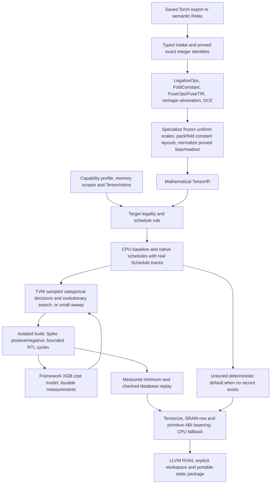

> Historical record, frozen before the curated handoff. Commands and missing-feature
> claims below may be superseded. Start with [README.md](README.md).

# Gemmini compiler status after external review

The review of `1a8e981` was correct: all 842 tests passed, but the original short
searches did not establish tuning gains. All performance numbers below are bounded
RTL-model results or explicitly historical. No FireSim execution or pretrained
whole-model quality result is claimed. Implementation/evidence is tracked in
[REVIEW_ACTIONS.md](REVIEW_ACTIONS.md); the offline compiler handoff is in
[FIRESIM.md](FIRESIM.md).

All retained learned parameters use the diagnostic script’s own `seeded_weights`
pattern, `((index*37 + module_ordinal*101 + field*53)%251 - 125)/512`, rather than
the public modules’ default initialization. Calibration is a small separate
seeded stream; recipe digests and held-out numerical gates are retained.

## What changed

| Review issue | Current behavior |
| --- | --- |
| Missing default comparison | CPU and true untuned default measured first, within the trial budget; restricted grids retain both. Only a checked measured minimum wins |
| Redundant/padded candidates | Groups cannot extend beyond useful output tiles; unit-axis traversal duplicates and collapsed K choices are pruned; normal DMA order is AB |
| Tied custom ML choices | CLI `ml`/`metaschedule` uses `tune_tasks`, EvolutionarySearch, standard XGBModel, sampled categorical decisions and a real mutator. Prediction diversity and ties are reported |
| Copies issuing scalar commands | Copies default to CPU. Rectangular failure keeps CPU fallback. Scalar DMA requires explicit diagnostic selection; a measured record can override placement |
| Runtime constant-weight repacking | `layout_free_buffers`, real layout transforms, layout-preprocessing split and FoldConstant pack frozen weights once; runtime input windows remain CPU work |
| Search abort/lost trials | Each success/failure is journaled and fsynced; failed builds/runs are isolated; resume checks workload/profile; deadlines cover isolated builds, target cycles and host wall time |
| Missed CNN ReLU/requant fusion | Both eligible CNN sites use native scalar scaled ReLU readout, with equal output-code thresholds proved over every INT32 input and independent RTL boundary tests |
| Costly software byte rounding | Guarded bounded byte quantization clamps before hardware RNE conversion. General floating round semantics remain unchanged |
| Archive metadata/constant ownership | Serialized export imports recover metadata and own aligned immutable constants; no alias to mutable source tensors |
| K=1024 carrier restriction | Frozen-weight L1 prefix bounds extend exact FP32 carrier eligibility; integral bias needs a separate bound. Unproved/fractional cases keep CPU semantics |

`RewriteLayout` in this pinned v0.19 tree cannot infer the conditional padded conv
maps used here. The backend supplies those schedule/index maps, marks standard
layout-preprocessing blocks, then uses SplitLayoutRewritePreproc and FoldConstant.
This is a disclosed target-specific normalization, not a repaired general layout
inference pass. Constant packing and bias/readout normalization are outer pipeline
choices, not automatic graph-wide DSE decisions.

## Pass architecture and framework usage

Hardware registration happens at backend import: an LLVM/RV64 target key/model
fingerprint, explicit capabilities/scopes and reference/implementation TensorIntrins.
It is not discovery from a device, a new graph op or a custom C++ target kind.
The graph pass chooses legal structural candidates; standard Schedule operations
own split/reorder, padding, cache placement, layout transforms, reduction init and
tensorization. Unsupported work remains ordinary CPU TIR. The C adapter issues
primitive OS commands; there is no whole-op library substitution in this arm.

The normal tuning controller uses framework Builder/Runner callbacks and a
PerStoreFeature extractor on mathematical pre-tensorization traces. Its internal
RunnerResult cost is cycle-valued: XGB relative-cost units cancel. This adapter is
explicit; it is not seconds and there is no invented clock conversion. Public
cycle receipts retain their own units; replay databases have no fabricated
second-valued run_secs. The old custom ranker/API and legacy template route remain
for compatibility/diagnostics, and are not the CLI ML controller.

## Execution and exact datatype boundaries

These EL4 recipe slices use static tensor INT8 activation grids and frozen signed
INT8 learned weights with a shared scale per 16 output channels. Attention uses
static per-head scales; this differs from the earlier dynamic per-token proposal.
Calibration follows the pinned histogram/minmax recipes with epsilon `2^-12` and
eight separate seeded calibration samples, with a held-out numerical gate. The
TinyLlama head has one integer QK and four PV plane products; the SmolVLA head has
four score and four context products. FP32 residual planes, softmax/normalization,
rescaling, RNE and denominator division remain source mathematics. The recipe
leaves small activation reductions (K<=16) floating; preserving those sites does
not satisfy an all-integer-contraction deployment policy. Source epilogues follow
INT32 bias/ReLU, FP32 conversion/scale, RNE, INT8 clamp and optional pooling; the
compiler fuses only when that exact sequence is proved equivalent.

| Operation | Gemmini execution | CPU execution / exact conditions |
| --- | --- | --- |
| Signed INT8 product | 16x16 OS MACs, SRAM transfers, INT32 output | Positive static K <= 131071; 20-bit PE chunks <=16; admitted layout/alias/SRAM. Larger modulo-32 source reductions stay CPU |
| Learned linear and forward conv | Same product after carrier proof | Scale-one/zero-zero INT8-to-FP32 carriers: K<=1024 or frozen-weight L1 bound <=2^24; general FP32/FP16/BF16/unproved prefixes stay CPU. Runtime input-window staging remains CPU; frozen weights pack at compile time |
| Bias | Proved INT32 scalar/vector/matrix accumulator preload/add | Integral frozen FP32 bias moves only when all product prefixes plus bias fit exact FP32 integer range. Fractional or unproved bias stays FP32 CPU |
| ReLU and requant | Standalone exact INT8 ReLU; eligible INT32-derived scalar scaled INT8 readout, including both CNN sites | Positive finite scalar FP32 factors, exact RNE and [-128,127] saturation, optional ReLU, zero output zero-point; complete INT32 output-threshold proof. Per-lane/dynamic scales, unequal double rounding, other clamps/zero points keep CPU math. Scale <=2^31 also keeps pinned Spike INT64 conversion defined |
| Q/DQ and rounding | Only the proved contraction readout above | General affine scales/zero points, FP32 conversions and RNE on CPU. Bounded guarded byte RNE uses hardware fcvt; arbitrary nearbyint remains floating/library semantics |
| INT32 add / bounded INT8 sum | Coefficient-one accumulator add; sum via ones-vector contraction | No INT32 input scaler; exact broadcast/ownership and integer overflow bounds required. Floating sums/means and arbitrary alpha remain CPU |
| Softmax, normalization, SiLU/GELU, RoPE, embedding, floating residuals | Only independently admitted integer contractions | FP32 reductions/exp/rsqrt/affine/division, gather, comparisons and general elementwise math stay CPU; Gemmini has no floating ALU |
| Copy/pad/transpose/slice/concat/fill | Optional proved rectangular INT8/INT32/raw-FP32 DMA and exact signed widening | CPU by default; no implicit 1x1 DMA fallback. Scalar movement is explicit diagnostic support. FP32 payload transport does not implement floating arithmetic |
| Views | Often folded metadata | ABI/materialization copies as needed; no unsupported hidden aliases |
| Pooling, FP32 adjoints/scatter | No native general floating reduction/scatter | CPU; store max-pool is a hardware capability not yet exposed here; max-pool is not mean pooling |

The hardware profile has 256 KiB scratchpad, 64 KiB accumulator SRAM, full-width
readout and narrow scalar floating scale/ReLU. Registered code uses OS only.
Primitive WS, scaled INT8 loads, store max-pool, double buffering, asynchronous
overlap and cross-function SRAM residency are implementation gaps. Hardware loops
remain forbidden; enabling them requires a separately labeled library/FSM arm and
RTL/deployment validation. Matching a target name does not expose these features.

The old 39-op report observes source op spellings/site counts, then joins maintained
semantic descriptions. Its dtype/limit prose was never inferred dispatch. New
function placement and simulator results must come from the corresponding bundle,
not from those strings. The older [51-op inventory](TENSORIR.md#full-requested-operator-inventory)
is a historical functional capability exercise with explicit movement opt-in,
not current production placement or universal dtype support.

## Measurements and validation

The reviewer exhaustively measured 49 old 8x16x8 candidates: default ij/AB/K16/1x1
was **462 cycles**, CPU **9578** (20.7x isolated speedup). Original four-trial ML
1452/sweep2920 results were 3.1x/6.3x slower than default, not tuning improvements.
Tied predictions meant seeded exploration, not useful ranking. The old score
winner's 1.7% improvement lies inside measured roughly 2% variation.

The review's old end-to-end CNN 146390/154920 and MLP 5129/5805 Gemmini/CPU cycles
are historical 1.06x/1.13x comparisons. Do not combine their CPU denominators with
new compiler results. The [follow-up report](../../../tensorir-dev/review-followup-v1/report-final-v2.md) records new matched comparisons,
function costs, exact receipts, cycle/host bounds and failures. Spike counters are
never target timing labels. Warm RTL intervals include model_run admission and
completion after one warmup; startup, oracle checks and HTIF are excluded.

The former decode cutoff is explained: default scalar DMA generated 14190 commands,
including 11141 from one RoPE function. CPU-copy placement removes that pathology.
The larger correctness-only decode check passes both RTL controls within 4M cycles;
the previous 2M timing bundle remains explicitly incomplete. Correctness-only runs
do not establish latency. Full-INT32 readout threshold boundary cases pass Spike
and RTL with wrong-oracle rejection, including signed tiny/large scales and both
actual CNN scale bit patterns.

Native standard MetaSchedule previously completed six 32x4x8 trials: CPU 9144,
default 676, two-row reuse599 cycles, with trained prediction diversity. This is a
small RTL-model experiment, not a general model or FireSim gain. All source freezes,
failed/incomplete attempts and subsequent corrections remain separately retained.

The final native framework run completed all six 32x4x32 trials without failure:
CPU **40209**, default **1178**, measured winner **987 cycles**. Saved native and
CPU winners replay successfully in a fresh process. Standard XGB warmup was four
observations: earlier predictions are random warmup, even if a fitted booster
already exists; subsequent model predictions had 2–4 distinct values over 32
candidates. This is measured schedule selection, not a universal speedup claim.

All five actual CNN functions now have complete CPU/default checks (cycles):

| Captured function | CPU mathematical candidate | Gemmini default | Selected |
| --- | ---: | ---: | --- |
| First fused conv | 103300 | 36727 | Gemmini |
| First scaled-readout conv | 10068 | 1458 | Gemmini |
| Second scaled-readout conv | 71143 | 43210 | Gemmini |
| Residual conv | 40888 | 8449 | Gemmini |
| Classifier | 519 | 563 | CPU |

These CPU candidates share the exact target-normalized function ABI; they are
not a broad CPU schedule search or the ordinary whole-graph CPU baseline.
The actual decode score function also selects CPU: **5544 versus 6957 cycles**.
The separate synthetic product with the same geometry measured CPU 4949; those
are different function/input/ELF scopes, not interchangeable denominators.
The package compiler consumes these records without model-specific choices.

The full follow-up suite passed **875 tests**. After the small CPU bias-broadcast
storage-scope repair, **41 affected export/bias/packing/harness tests** also passed.
The final native CNN archive is byte-identical to the RTL-qualified archive after
that CPU-only alternative fix. Archive-based boot ELF checks include constant
immutability, positive/wrong-oracle controls and measured stack high-water (688
bytes for the default CNN fixture versus a 16 KiB reserve). Per-run receipts and
all incomplete earlier attempts are retained in the generated follow-up report.

The final cost-gated CNN and decode packages both pass Spike and Verilator
positive/wrong-oracle checks. The CNN median is **98897** cycles against the
matched ordinary CPU graph’s **127016**; default native was99010, so the small
113-cycle change is not claimed as a graph tuning gain. MLP remains **2734/3411**
Gemmini/CPU. The final package stack high-water values are **784 bytes (CNN)** and
**1152 bytes (decode)** within 16 KiB reserves. Decode qualification is correctness
only, with no new latency claim. The final generated report covers 135 execution
receipts across 43 explicit bundles and retains the failed/incomplete predecessors.

## What TVM optimizes, and what still needs exploration

Normal graph fusion, constant folding, mathematical simplification, liveness/workspace
planning and LLVM lowering already run at compilation. The target rule expresses
real schedule alternatives: CPU/native placement, ij/ji traversal where useful,
PE-safe K4/8/16 chunks, legal row/column reuse groups and explicit movement/sum
variants. Reuse groups are genuine sample_categorical trace decisions; the target
mutator changes them through standard Trace decisions. Numeric bounds, no-FSM,
OS-only implementation, fixed SRAM geometry and required completion dependencies
are constraints, not tunable costs.

A small exhaustive sweep measures all remaining candidates. Larger spaces can use
the standard cost model/evolutionary controller. Predicted ties are reported; only
correct completed observations select a winner. Per-function CPU/native checks
include dynamic staging, but not all inter-function cache/lifetime effects.
Graph fusion/bias/packing decisions, CPU schedule tuning, async overlap and new
hardware intrinsics are not jointly searched. FireSim must remeasure choices under
its actual timing/memory/cache profile before production selection.

## Fork changes and deployment blockers

This is a **TVM-generated primitive backend in a disclosed fork**, using standard
Relax/TensorIR/MetaSchedule extension points. It is not unmodified upstream TVM,
a vendor-library performance arm, or stock microTVM/AOT deployment.

The migration retains twelve modified C++ core files plus a TOPI header repair,
Python correctness fixes, a scalar-offset compatibility bridge, target SRAM row
lowering and a custom static `call_tir` exporter. The older audit explains each
core repair and its independent tests. New source intake adds `_int_mm`, RNE,
stack/one-sided clamp/metadata/where/max conversions, Q/DQ, proved integer carrier
normalization, FP32 RMSNorm/flatten/chunk and Torch 2.10 inference-BatchNorm/cast
compatibility. These are explicit framework patches, not monkeypatches applied
at runtime or model-name-based device selection.

Remaining deployment gates are actual bitstream/driver/loader/HTIF and DRAM
qualification, realistic checkpoint/calibration/task-quality captures, whole-size
stack/storage/cache ownership checks and matching end-to-end FireSim intervals.
These are distinct from the completed local compiler proof. No model-specific
hard-coded lowering, runtime monkeypatch or hidden numerical recipe change is used.
See [FIRESIM.md](FIRESIM.md) for explicit artifacts, commands and boundaries.
