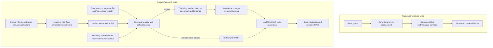
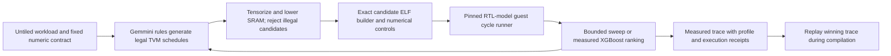

> Detailed development notes, including historical checkpoints. Current ownership
> and supported entrypoints are in [README.md](README.md) and [OWNERSHIP.md](OWNERSHIP.md).
> For current tuning use [TUNING.md](TUNING.md); historical commands below are not the runbook.

# Gemmini through mathematical TensorIR

Development branch: `gemmini/tensorir`, based on `6b376cc8895a83387ec38cc06ef8f7b09827b071`.
The original checkout and branch remain unchanged. The old template backend is
available as `prepare_gemmini_graph(..., route="legacy")` and
`prepare_gemmini_graph_legacy`; its tests explicitly select that route.

> Historical migration record: the implementation and qualification tables below
> describe the earlier source freeze, including explicit movement-capability
> fixtures. Current production placement, sampled MetaSchedule, weight packing,
> readout fusion and compiler packaging are documented in [EL4_STATUS.md](EL4_STATUS.md)
> and [FIRESIM.md](FIRESIM.md). Do not interpret the old DMA placements as current defaults.

## Required end state

This migration is complete only after the framework integration, requested
operator inventory, regression checks and bounded Spike/Verilator checks are
verified. A passing small matmul does not complete the migration. The user also
requires exact explanations for requested operations that cannot map to the
selected hardware and numerical contract.

## Frozen migration qualification

The current recipe, measured-search work and deployment limits are documented in
[EL4_STATUS.md](EL4_STATUS.md). This section records the earlier functional
migration freeze; its receipts must not be relabeled as new-source or full-model
performance qualification.

The migration is qualified at source revision
`19b96df8cc366481220a8d618397b204fb5f61bd`. All 51 requested operator spellings
execute at the explicit dtype/shape contracts in `operator_contracts.py`.
Twelve bounded bundles cover those operators and eight further regression
fixtures on both Spike and the pinned Verilator RTL, with wrong-oracle controls.
All 908 collected checks in the focused regression suite pass. The final record is
`../tensorir-dev/operator-support-inventory-v1.json`; the closing acceptance
record is `../tensorir-dev/qualification-inventory-final-v1.json`.

For the requested contracts, five use array arithmetic, three use accumulator
addition, one uses narrow ReLU, 21 use native movement, four combine native
movement with CPU arithmetic, twelve use CPU arithmetic, and five fold away or
need only metadata/ABI copies. Native products may still need a CPU output cast
or epilogue. This is functional operator qualification, not universal overload,
dtype, layout, model or performance qualification. No requested spelling remains
an importer TODO within this scope; unsupported contracts are listed explicitly.

The legacy template branch remains `gemmini/legacy-template` at the base commit.
The frozen route is an untuned TVM-generated primitive backend with an explicit
integer hardware profile. It is a fork with disclosed correctness patches and
custom static packaging, rather than an unmodified upstream performance result.

Hardware registration is independent of graph matching. The profile exposes the
selected device, supported instruction subset, scopes, resource bounds and
numeric constraints; it does not discover a device or make every op native.
The custom rule chooses legal framework transformations. TVM does not infer
Gemmini scheduling from a target name alone.

## Scheduler and design-space exploration status

`prepare_gemmini_graph(..., optimize=True)` already runs ordinary legalization,
constant folding, binding canonicalization, FuseOps/FuseTIR, eligible reshape
elimination and dead-code elimination before target scheduling. There is no
later switch that makes TVM independently invent the Gemmini implementation.
Target rules provide legal transformations and intrinsic substitutions.

| Component / decision | Current status | Who chooses; remaining limit |
| --- | --- | --- |
| Mathematical graph simplification and fusion | Active in the normal preparation pipeline | Standard Relax passes; numerical policy stays explicit |
| Tiling, loop traversal, reindex/layout, cache placement and producer/epilogue placement | Actual TVM Schedule operations, with replayable traces | Target rule chooses legal patterns; not every TVM transformation is exposed to search |
| Target registration and matching | LLVM/RV64 Gemmini key/profile, independent TensorIntrin families, structural TIR matching | Explicit selected hardware profile; not device discovery or complete modeling of every RTL feature |
| CPU-versus-Gemmini placement | Default compilation remains legality driven; measured search exposes an ordinary CPU alternative | `include_cpu=True` retains an honest CPU candidate. Profitability has only bounded RTL-model measurements, not full-model/FireSim qualification |
| Contraction candidates | Up to 72 default combinations; 108 with K=4 added in DSE, plus CPU | Traversal, input issue order, PE-safe K chunks and row/column groups; legality/deduplication reduce the space |
| Movement/reduction candidates | Rectangular/divisor versus scalar strategies | Narrower space; multiple copy regions currently share one strategy choice |
| MetaSchedule integration | PyScheduleRule + PostOrderApply + RewriteTensorize + SRAM legality postprocessor | Standard candidate generation/postprocessing works; traces and feature extraction are checked |
| Timing builder/runner and tuning driver | `tune_tensorir.py` builds exact candidate ELFs, checks Spike controls and collects bounded RTL guest cycle intervals | Pinned magic-memory RTL scope, warmup/repeats and receipt checks; not FireSim timing or stock local x86 execution |
| Cost model | XGBoost ranks standard pre-tensorization PerStoreFeature vectors by log cycles; bounded sweep is also implemented | Four-trial experiments exercise the loop. No validated cross-workload model, convergence or generalization claim |
| Production schedule selection | Matching database record, otherwise deterministic untuned default | Compilation itself does not call tune_tir/tune_tasks or iterate over all candidates |
| Database identity and replay | Workload plus target/profile checks | Existing mismatched profile records are refused; any changed numerical graph/schedule space needs appropriately new records |
| Search mutations | No target mutators registered (`mutator_probs={}`) | The initial space is bounded by our rule; no claim of a broad evolutionary exploration |
| SRAM allocation | Standard allocation placement/compaction, then checked target row mapping | Current row allocator is conservative and does not reuse different region buffers by disjoint lifetimes |
| Bias and output fusion | Proved INT32 bias normalization can be enabled/disabled; ordinary CPU epilogue placement | Outer pipeline option, not automatically jointly searched by the function tuner. General requantized readout fusion is absent |
| Cross-operation SRAM residency | Cache reuse within a scheduled PrimFunc | No general SRAM handoff between separate call_tir functions; host writeback and subsequent reload remain |
| Primitive command implementation | Small C ABI wrappers issue the ISA commands | TVM cannot optimize inside those wrappers. Configuration elision/coalescing and primitive-call inlining are not searched |
| DMA/compute overlap | Correct dependency waits/completion | Software pipelining, double buffering and asynchronous overlap search are not implemented |
| CPU fallback optimization | Standard TVM/LLVM lowering and legal producer inlining | No Gemmini-specific CPU tuning campaign; CPU gathers, division, casts and quantization remain part of end-to-end cost |

The contraction knobs are host traversal `ij/ji`, A-before-B versus B-before-A
issue order, PE-safe K chunks 8/16 (also 4 in the new DSE), and row/column cache groups 1/2/4.
The 16x16 physical array, exact arithmetic, SRAM bounds and completion rules are
constraints, not adjustable performance knobs. Within a chosen legal parameter
set, TVM carries out the transformations and records them; the current rule does
not search arbitrary layouts, fusion boundaries, loop interchange permutations,
DMA channel assignments, tail algorithms or software pipelines.

The implemented bounded optimization loop is:

The current driver uses standard TuneContext/candidate generation, postprocessors,
semantic feature extraction and ScheduleFnDatabase replay, with an explicit
cycle-valued measurement/search loop. It does not fabricate second-valued
TuningRecord costs or claim integration into the stock second-valued tune_tasks
runner. The old `gemmini_tuning.py` belongs to the retained template route;
new TensorIR evidence is in `el4-dse-v1`. A learned model ranks candidates; only
correct, completed measurements select a winner. Whole-graph and FireSim
profitability remain unqualified. See the newer status document for exact scope.

Generic PerStoreFeature extraction also does not itself model Gemmini command,
configuration, DMA, fence or bank costs. Those costs need measurements and may
benefit from additional target features or a calibrated analytic model.

### Remaining work before optimization campaigns and a deployment compiler

| Priority / purpose | Concrete remaining work | Why it matters |
| --- | --- | --- |
| Required before claiming model support | Run representative complete imported graphs with their actual dtypes, quantization, scales, layouts and shapes; report native arithmetic/DMA/CPU separately | The 51-op campaign is small-contract functional evidence, not full-model or universal dtype support |
| Required before collecting optimization labels | Keep the existing hardware/profile and primitive/no-FSM policy pinned; choose and qualify the timing substrate and exact model recipes | Changing these changes the legal compiler and invalidates performance comparisons |
| Required before expanding measured DSE | Broaden the working bounded driver to representative post-fusion functions and whole graphs; qualify the deployment timing profile | Primitive RTL-model cycle costs and winners now exist; they do not establish model or FireSim performance |
| Required for useful end-to-end decisions | Include CPU staging, casts, dequantization, launch/configuration/fence costs, transfers and peak workspace in reports; compare the untuned route and preserved baseline | Fast array arithmetic alone may not improve whole-program execution |
| Required before model-wide cost-based placement claims | Expand compatible CPU alternatives and graph/fusion choices under end-to-end measurement | Current function search can choose CPU; default placement is still semantic/resource based and graph-level placement is not jointly tuned |
| Required when adding/reordering optimization passes | Keep semantic/fusion passes before target scheduling; inspect fallback reports and retune changed workloads; rerun correctness/resource checks for the resulting compiled artifacts | More fusion or a rewritten access map can change target admission and measured behavior |
| Required before final deployment claims | Qualify complete graph memory/ABI lifetimes, realistic sizes and numerical edge cases on the selected deployment substrate | Current static positive-span ABI, hidden-alias refusals and small simulator tests do not establish production deployment |
| Optional performance expansion after a measured baseline | Lifetime-aware SRAM reuse, less CPU gathering/reindexing, fewer scalar DMAs, cost-based fusion, better tails, overlap/double buffering, and larger search spaces | These are implementation/performance gaps; adding a cost model alone cannot create them |
| Separate hardware-feature expansion | Primitive WS scheduling, max-pool readout, proved scaled/requantized readout, or a separately allowed/labeled hardware-loop library arm | Supported RTL features are not automatically registered compiler capabilities; each needs semantics, intrinsics, schedules and target checks |

Dynamic shapes/hidden storage aliases, unsupported payload types, exact FP16
rounding refusals and source-CPU gaps remain explicit coverage limits. The fork
also retains custom static packaging, a scalar-offset compatibility bridge and
the generic correctness patches described below. No new core optimization pass
or numeric recipe should be treated as performance validated merely because the
existing functional inventory is green.

Fair comparisons also need the same input quantization, rounding, layouts and
ISA policy. A hardware-loop/library arm would be a separately labeled change
of implementation policy; raw FP32 DMA must not count as native FP32 arithmetic.

## Implemented architecture

1. Ordinary Relax `LegalizeOps`, pattern annotation, constant folding and
   supported `FuseOps`/`FuseTIR` retain mathematical computations.
   Standard `RewriteDataflowReshape` and `DeadCodeElimination` then remove
   eligible internal reshape copies and unused functions before device matching.
   `CanonicalizeGemminiBias` can then expose a proven bias-initialized integer
   reduction, separately from scheduling, retaining both mathematical forms.
2. `ScheduleGemminiTensorIR` recognizes contractions by their buffer accesses,
   arithmetic and reduction axes. Names do not select implementations. Unmatched
   functions retain CPU lowering; schedule refusals retain a reason.
3. TensorIR `split`, `reorder`, caches, producer placement, standard padding and
   reduction decomposition construct the execution schedule. The full trace
   replays from the untiled workload with all scheduling debug checks enabled.
4. `TensorIntrin` descriptions/implementations model scoped DMA, accumulator
   initialization, update and readout. Intrinsics are authored with typed
   TVMScript; no generated source strings are parsed.
5. Standard allocation location planning and compaction precede physical SRAM
   row allocation. CPU accesses to SRAM, unaligned rows and resource excesses
   are rejected. CPU-private DMA staging buffers require completion before reuse.
6. Static export uses ordinary LLVM RV64 code generation. TVM USMP assigns an
   explicit caller-owned pool when private allocations need workspace; the pool
   belongs in preflight accounting. Guest allocation callbacks remain forbidden.

The hardware target is LLVM/RV64 with a `gemmini` dispatch key and a capability
fingerprint in its model. Rocket executes the generated code and issues RoCC
commands, so this route does not need a new C++ `TargetKind` or LLVM codegen.
Intrinsics and target scheduling rules are registered independently of graph
matching. Registration describes an explicitly selected device; it does not
discover a connected accelerator or make arbitrary operators tensorizable.

Importing `tvm.relax.backend.contrib.gemmini` registers two standard Relax
pipelines. `relax.get_pipeline("gemmini", **options)(mod)` prepares mathematical
graphs for static export, retaining `call_tir`. For ordinary VM compilation,
`relax.build(mod, target, pipeline="gemmini_build")` composes that preparation
with TVM's stock `default_build_pipeline`. Options can be passed through
`relax.get_pipeline("gemmini_build", **options)`. The implementation does not
replace VM lowering or change the default pipeline for other targets.

This remains a TVM v0.19 fork rather than an unmodified upstream baseline. The
base commit already contains ONNX fidelity changes, FP/BF16 storage and strict
arithmetic fixes, source-preserving CPU recipes and the host-only `LowerAutoCopy`
guard described in README.md. That guard rejects unsupported automatic-copy
annotations and is not a DMA optimization.

The migration includes generic C++ scheduler/IR fixes. Including the pooling
and gradient work described below, twelve core C++ source files and one TOPI
header differ from the legacy branch.
In `decompose_reduction`, initialization reads were omitted and retained
on the update block instead. Separate read-region analysis preserves an
input-dependent initialization and lets subsequent cache placement see its
producer. The regression tests cover read dependencies, cache placement, trace
replay and CPU execution, independently of Gemmini.
In schedule-state replacement, shared statement containers such as `SeqStmt`
must trigger copy-on-write even when their child loop appears uniquely owned.
Otherwise splitting an inner loop can mutate the original workload and break
trace replay. General split/reorder tests retain and check the original input.
The handwritten static deployment packaging is retained, with standard USMP
used for operator pools; this is not a claim of stock microTVM/AOT deployment.

Constant-padding scheduling exposed three further general issues, each with
target-independent regressions. `decompose_padding`'s Python trace printer must
accept the loop's printed name rather than a LoopRV object. Repeated blockization
must give generated outer blocks unique names so ordinary `GetBlock` and
MetaSchedule tensorization can address them. Tensorization must compare floating
literal bits: numerical equality rejects an identical NaN and accepts opposite
zero signs. The matcher now preserves NaN payloads and signed zero. These are
explicit fork patches, not changes to the accelerator's arithmetic contract.

Copy-region scheduling exposed two more generic defects. `loop_partition` now
uses zero-based physical loops while preserving logical block domains and
access maps. The old implementation narrowed domains and rewrote regions by
display names, which could change a reduction's initialization or make a later
blockization simplify a copy selector incorrectly. Partitioning now renews
private definitions, derives wrapper dependencies and also handles a nonzero
input loop origin or a single partition. `RenewDefs` preserves a domain's
minimum/extent and the identities of externally defined buffers, including
metadata-only references. General regressions check CPU execution, private
allocations, dependencies and trace replay independently of the target.

Exact INT64-result sum scheduling adds two composability fixes. `unsafe_set_dtype`
uses the usual folding cast constructor for buffer stores, so an INT64 zero
becomes an INT32 zero rather than a redundant cast that Tensorize cannot match
after simplifying its descriptor. Tensorize refreshes the complete enclosing
scope's cached block information and preserves its existing affine binding;
starting at the scope's body can misclassify a tensorized block as a root.
Target-independent constant-initialization tests exercise both the INT32 and
INT64 producer cases, CPU execution and full trace replay. Python IndexMap
construction also converts integer literals to the requested index dtype;
otherwise a printed map containing a constant zero cannot replay in Python.

Pooling exposes additional generic correctness defects. One-dimensional ceil
inference must read its single stride rather than a nonexistent second entry.
TE reductions whose axes occupy multiple dependency levels must initialize each
output once before all reduction loops, including empty domains; initializing
each nested block resets partial results. Physical loops use zero-based domains
while block bindings preserve logical origins. Generic statement and index-dtype
rewriters must reconstruct domains with `Range::FromMinExtent`, not interpret an
extent as an endpoint. Independent CPU execution checks cover triangular and
rectangular domains, nonzero origins, input-dependent identities, tuple outputs,
both index widths and schedule trace replay. These repairs are independent of
Gemmini instruction selection.

Average-pool backward also needs its divisor clipped to the originally declared
padding when ceil mode extends the last window. The TOPI implementation had
always used the full kernel area for included padding. The repaired generic
operator agrees with an independent window Jacobian in both layouts and floating
dtypes; the normal non-ceil implementation is unchanged.

`gemmini_space_generator()` is a standard MetaSchedule `PostOrderApply` space
generator with a target-specific `PyScheduleRule`, standard `RewriteTensorize`
and a memory legality postprocessor. Up to 72 choices combine matrix traversal,
A/B issue order, PE-safe K chunks of 8/16 and row/column tile groups of 1/2/4.
Blocked B and accumulator layouts let one DMA load serve multiple tile products.
Independent command-count checks confirm reuse while preserving full and tail
results. This does not implement DMA software pipelining or double buffering.
Alignment is attached to the explicit blockized region consumed by Tensorize.
This matters for short grouped tiles: aligning only the original inner block
can lose the physical row pitch when that block is replaced. Memory lowering
also checks the sixteen-element row pitch (unless the row axis has extent one)
and contiguous columns. The sum intrinsic's private ones matrix explicitly
includes all sixteen physical columns, even though only column zero is used.

`ScheduleGemminiTensorIR` uses a matching current MetaSchedule database record
when present, otherwise a deterministic untuned schedule. The v0.19 default
database query ignores its target argument, so the backend explicitly compares
the returned record's target/profile before replay. The standard database test
uses a diagnostic invented cost solely to prove selection/replay; it is never a
target timing label. The later cycle-measured driver and bounded experiments are
described in [EL4_STATUS.md](EL4_STATUS.md); this paragraph describes the original
database integration test.

Noncanonical exact contractions use standard `transform_block_layout`,
`reindex`, `transform_layout`, producer inlining and `compute_at` to form matrix
regions from their access maps. Convolution therefore keeps ordinary Relax/TIR
semantics until scheduling. CPU window gathering remains necessary for layouts
that primitive rectangular DMA cannot express, but the placed staging regions
replace the old full im2col graph tensor. Quantization and pooling semantics
are not changed by this layout schedule.

Bias preload applies to a bounded, private, unshared INT8/INT32 product followed
by a bijective pointwise addition of a read-only INT32 tensor. The post-fusion
mathematical pass exposes bias initialization and explicit modulo-32 reduction
updates. This preserves the original defined results even when moving bias
earlier makes an intermediate prefix wrap; it also preserves explicitly wrapping
source additions. It does not make ordinary TVM integer arithmetic globally
wrapping. Reports retain the original/normalized IR and proof conditions; a
scheduling refusal restores the original CPU function.

Standard schedules inline vector/matrix bias or place a necessary scalar/column
broadcast gather near initialization, then tensorize full-width accumulator DMA.
The final product copy can inline into device writeback. CPU INT32/FP ReLU and
quantization remain separate. The wrapped reduction currently uses divisor
tiles because v0.19 `pad_einsum` does not recognize that expression; prime
extents may therefore require many tiny commands. Cache groups that do not
divide those extents are rejected. Bias preload is enabled by default and can
now be disabled as an explicit outer pipeline choice. It has not been jointly
tuned with graph fusion, and no bias fusion speedup is claimed.

## Hardware evidence and numerical boundaries

Facts were inspected in the selected local Chipyard/Gemmini source and matching
generated parameter header. `GemminiCapabilities` binds the target model to its
profile digest; it is an explicit compiler profile, not hardware discovery.

The hardware profile is not a complete RTL performance model. The following
distinction matters when deciding which optimizations are still missing.

| Selected RTL capability | What this backend exposes today | Missing or fixed policy |
| --- | --- | --- |
| Signed INT8 inputs/weights, 20-bit PE output, INT32 accumulator; 16x16 array | Exact bounded integer contraction/sum TensorIntrins | No native floating or wider-input arithmetic; CPU quantize/dequantize remains explicit |
| 256-KiB scratchpad, 64-KiB accumulator; 4 SPAD banks / 2 accumulator banks | Scoped caches, layout/alignment, capacity checks and physical row mapping | No bank-aware cost model or lifetime reuse of separate region SRAM buffers |
| Both output-stationary and weight-stationary dataflows | Primitive OS only | WS primitives are a backend gap; WS is not inherently equivalent to using a hardware-loop command |
| INT8 mvin floating scale with round-near-even and INT8 saturation | Identity scaling and exact signed widening in admitted paths | General scaled-load semantics/intrinsics are not exposed |
| No INT32 accumulator-load scaler (`mvin_scale_acc_args=None`) | Unscaled overwrite/add | Cannot assume native full-width alpha/-1 scaling |
| Full-width accumulator readout | INT32 values and raw FP32 bits | Full-width path bypasses activation/scaling; it is not FP32 arithmetic |
| Narrow scaled/activated INT8 readout | Exact identity-scale INT8 ReLU only | General requantization, clipping/rounding equivalence and profitable fusion are not implemented |
| Max-pool store path enabled | Not registered by this backend | A potential native max-pool feature; does not implement average pooling |
| Integer training-convolution and loop-convolution features enabled | Mathematical CPU gradients or admitted integer contractions | These are integer-array features, not a floating training unit. No direct use here; LOOP_WS/LOOP_CONV remains forbidden by policy |
| Optional normalization hardware | `has_normalizations=false` in the selected default configuration | Do not infer native layernorm/softmax/GELU from other Gemmini configurations |
| DMA queues/bandwidth and three mvin channels | Explicit A/B/accumulator command streams and correct waits | Queue-depth/bandwidth facts are not used by a measured cost model; overlap/channel assignment are not searched |

These facts were read from the selected `Configs.scala`, `GemminiConfigs.scala`,
`AccumulatorScale.scala` and `StoreController.scala`, not inferred from the
Gemmini project name. Scale is configured per command stream and can be changed
between transfers; the missing current vector-scale/FP32-result lowering should
not be described as a universal tensor-wide silicon restriction.

| Source | SHA256 | Relevant facts |
| --- | --- | --- |
| `gemmini/Configs.scala` | `178c21ac741c89c08158efa71fb34da35d27b75bd50bde5116a5e19178f8391b` | INT8 inputs, INT32 accumulator, 20-bit PE output, 16x16 array, both dataflows, 256-KiB scratchpad, 64-KiB accumulator; no accumulator-load scaler |
| `gemmini/GemminiConfigs.scala` | `7294a082a1df4ae7aa7d81adc5bde75b7d5118683c083f6a4b998c9ce64d102e` | Configuration fields and optional units |
| selected `gemmini/LoadController.scala` | `780ee0a292d8653fa8a822aee28e2fb2cffbc25301431b4332182008d34fcf6a` | Null DMA address produces zeros; stride zero broadcasts a row |
| selected `gemmini/AccumulatorScale.scala` | `bb7c65bdf112e5ab93da52278e5c30152fb2f84a8ed990d23008439cf41281d4` | Narrow output applies activation/scale/clipping; full-width data follows a separate unchanged path |
| selected `gemmini/StoreController.scala` | `a0b556d109196c3c9d9ac5ed4dffc1bcad334c0f1f87780d948b84bde7402c6d` | Store configuration supplies activation and accumulator scale |
| `include/gemmini_params.h` | `3758ae967af3a179497660970201093a7fb624be00173990ce33d3f5c38da924` | Parameter/ABI geometry and float scaling/narrowing definitions |

The implemented instruction subset is primitive-only OS; hardware loops remain
forbidden. The selected existing RTL source has a previously disabled debug
assertion in LoadController; this migration does not edit RTL. Simulator and
software source digests must accompany each execution result.

Scaling an INT8 load rounds and saturates back to INT8. INT32 accumulator loads
have no configured scaler. Narrow readout rounds/scales/saturates to INT8; full
INT32 readout is a different path. These features are not arbitrary FP32 or
INT32 multiply/divide operations. In particular, negating INT8 -128 during a
scaled INT8 load saturates, whereas widening then negating produces INT32 128.
Any lowering must preserve the admitted operator's actual dtype and rounding.

The target profile explicitly records full-width readout and narrow-readout
ReLU, both enabled in this pinned configuration. Native INT8 ReLU widens each
tile into a private INT32 accumulator, then uses identity-scale narrow ReLU
readout. Every INT8 value is exactly representable at both steps; all 256 values
are checked on the target. One typed tile intrinsic describes the entire
sequence, with its owned accumulator allocation retained in a nested block.
TVM chooses tile loops and rectangular/scalar access strategies; the temporary
and its two-command sequence are fixed intrinsic implementation details. No
arbitrary INT32 narrowing or floating ReLU is implied.

FP32 copies use full-width DMA as raw 32-bit transport, with no scale or
accumulation. The floating buffer type remains visible in mathematical TIR;
the physical words preserve NaN payloads, signed zero, infinities and subnormals.
Runtime scalar FP32 fills and indexed repeat/copy layouts use the same typed
copy rules. This adds data movement, not floating accelerator arithmetic.

## Full requested operator inventory

**Where execution happened:** the same RV64 Rocket program ran inside Spike and
inside the pinned GemminiRocketConfig Verilator testbench. Rocket executes every
CPU fallback, stages data, issues accelerator commands and waits for completion.
The Gemmini columns below identify the tensor arithmetic or data movement
performed by the accelerator. Host command issue is common to every native path.
No physical FPGA/board or FireSim run is claimed.

**What PASS means:** all 51 requested spellings execute correctly at the listed
small, static contracts. It does not mean 51 native arithmetic implementations.
There are nine requested contracts with Gemmini arithmetic, 21 with Gemmini
movement, four with Gemmini movement beside CPU arithmetic, twelve with CPU
arithmetic, and five folded/elided or copied by the static return ABI.
The final guest checks distinguish array compute, DMA-only work and CPU work.
No quantization is inserted automatically to improve these counts.
The report fields `placement="gemmini"` and `native_functions` count functions
containing selected accelerator regions. Such a function can also contain CPU
reduction blocks: FP32 average pooling and convolution backward are examples.
They must not be interpreted as counts of fully native arithmetic operators.

### Qualified contracts for all 51 spellings

The dtype column is the final campaign's actual fixture dtype, not every
supported source overload. C1-C6 below describe the implemented native contract
or why CPU work remains. Exact shapes, source overloads and receipts are in
[`operator-support-inventory-v1.json`](../../../tensorir-dev/operator-support-inventory-v1.json);
[`operator_contracts.py`](operator_contracts.py) reproduces the captures.

#### Arithmetic and linear maps (25)

| Requested spelling | Actual fixture dtype | Work on Gemmini | Remaining Rocket CPU / compiler work | Native contract or CPU reason |
| --- | --- | --- | --- | --- |
| `mm` | int8 → int8 | Array: INT8 products, INT32 accumulation | Restore source INT8 result with a wrapping cast; staging where needed | C1: INT8 operands only; no implicit floating quantization |
| `bmm` | int8 → int8 | Array contraction per batch | Batch/command loops; source INT8 output cast and necessary staging | C1: same integer contract for each admitted batch |
| `addmm` | int8 → int8 | Array product; no bias preload in this ATen INT8 fixture | Exact INT8 output/bias semantics | C1: separate INT32-bias preload is implemented and tested by bias_prefix; this INT8 bias is not preloaded |
| `convolution` | int8 → int8 | Array products for an INT8 forward contraction | Window/layout staging, bias and source INT8 output conversion | C1: signed INT8 contraction; no LOOP_CONV; other admitted dtypes keep CPU arithmetic |
| `convolution_backward` | float32 → float32, float32, float32 | DMA copies/zero regions only; no array arithmetic | All FP32 gradient products, reductions and bias gradient | C6: unquantized FP32 gradients cannot use this integer array; two selected functions contain movement, not native gradient arithmetic |
| `add.Tensor` | int32 → int32 | Accumulator overwrite/add/full-width readout | Address/control work; no CPU output-tensor add | C2: INT32 unscaled addition; explicit modular reference where wrapping is required |
| `sub.Tensor` | int32 → int32 | None | INT32 tensor subtraction | C2: no full-width negative load scaler or registered general subtraction lowering; this is not a claim that every emulation is impossible |
| `add.Scalar` | int32 → int32 | Accumulator add of a broadcast INT32 constant | Materialize the scalar; address/control work | C2: known scalar folds to the source INT32 modulo contract; runtime scalar tensors also have a separately tested path |
| `sub.Scalar` | int32 → int32 | Accumulator add of the negated constant | Fold the known offset modulo INT32; materialize scalar | C2: constant subtraction is supported; arbitrary runtime tensor subtraction is not inferred from this |
| `mul.Scalar` | int32 → int32 | None | Full-width INT32 multiplication | C2/C6: scaled narrow readout saturates to INT8 and is not this wrapping INT32 operation |
| `div.Scalar` | int32 → float32 | None | INT32-to-FP32 conversion and FP32 division | C6: hardware scaled readout does not return arbitrary FP32 values |
| `neg` | int32 → int32 | None | Full-width INT32 negation | C2/C6: no INT32 load scaler; INT8 saturating -1 scale also disagrees with wrapping negation at -128 |
| `relu` | int8 → int8 | DMA signed widening, then identity-scale narrow ReLU readout | Address/control work; no CPU output-tensor ReLU | C3: exact INT8-to-INT8 ReLU; INT32/FP ReLU is not provided by full-width readout |
| `mean.dim` | float32 → float32 | None | All FP32 reduction and division | C4/C6: FP32 input; explicit integer sum plus CPU divide is a different admitted graph, not an automatic conversion of this mean |
| `avg_pool1d` | float32 → float32 | Raw FP32 padding fill/copy DMA only | All window sums and division | C6: max-pool hardware is not average pooling; numerical padding/divisor rules remain CPU |
| `avg_pool2d` | float32 → float32 | Raw FP32 padding fill/copy DMA only | All window sums and division | C6: no native FP32 average arithmetic; preserve ceil/padding/divisor semantics |
| `avg_pool3d` | float32 → float32 | Raw FP32 padding fill/copy DMA only | All window sums and division | C6: movement tensorization does not make the reduction native |
| `adaptive_avg_pool1d` | float32 → float32 | None | FP32 variable-window sums and division | C6: integer array cannot consume arbitrary FP32 values |
| `_adaptive_avg_pool2d` | float32 → float32 | None | FP32 variable-window sums and division | C6: variable windows and FP32 result are not implemented by narrow scaled readout |
| `_adaptive_avg_pool3d` | float32 → float32 | None | FP32 variable-window sums and division | C6: floating averaging stays CPU; the exact underscore overload is tested |
| `avg_pool2d_backward` | float32 → float32 | None | FP32 division and overlap accumulation | C6: local INT32 accumulate-on-load is not host FP32 scatter-add |
| `_adaptive_avg_pool2d_backward` | float32 → float32 | None | FP32 variable-window division and overlap accumulation | C6: same dtype/scatter boundary; no native gradient claim |
| `col2im` | float32 → float32 | None | FP32 overlap gather/reduction | C6: rectangular DMA has no general host floating scatter-add; other admitted CPU contracts are described below |
| `mean.default` | float32 → float32 | None | All FP32 global reduction and division | C4/C6: floating mean is not a narrowing readout scale |
| `sum.dim_IntList` | int8 → int64 | Array sum using an INT8 ones vector and INT32 accumulator | Input reindex staging; restore requested INT64 output/layout | C4: signed INT8 values, K <= 2^24; floating/wider-input sums stay CPU |

#### Data movement and creation (15)

| Requested spelling | Actual fixture dtype | Work on Gemmini | Remaining Rocket CPU / compiler work | Native contract or CPU reason |
| --- | --- | --- | --- | --- |
| `clone` | int8 → int8 | None in this fixture | Compiler elides functional clone; CPU ABI copy returns an input-backed result | C5: a real materialized INT8/INT32/FP32 copy has a native DMA path; clone itself is not counted as an accelerator call here |
| `repeat` | int8 → int8 | DMA copies of the selected source elements | Index/control and any required staging | C5: registered INT8/INT32/FP32 payload types; rectangular or scalar DMA |
| `cat` | int8 → int8 | DMA copies of proved source regions | Region bounds/index/control work | C5: static region partition; runtime predicates or excessive/unproved regions keep CPU math |
| `slice_scatter` | int32 → int32 | DMA copies for base and updated regions | Static slice/index/control work | C5: functional new output, static bounds, positive steps; no in-place/hidden-alias guarantee |
| `select_scatter` | float32 → float32 | Raw FP32 DMA for selected regions | Index/control and any required staging | C5: bit transport only; no floating addition or scatter-add |
| `fill.Scalar` | int32 → int32 | None in this constant fixture | Compile-time constant plus ABI return copy | C5: runtime scalar-buffer and unfolded literal DMA fills are separately tested |
| `full` | int32 → int32 | None in this constant fixture | Compile-time constant plus ABI return copy | C5: separate unfolded INT32 and FP32 creation fixtures require actual DMA |
| `full_like` | int32 → int32 | None in this constant fixture | Captured shape/dtype creation folds; ABI return copy | C5: folding is compiler work, not native fill execution; primitive fill support exists independently |
| `constant_pad_nd` | int8 → int8 | DMA broadcast fill plus interior copy | Boundary/cropping calculation and command control | C5: admitted INT8/INT32/FP32 literals; preserve exact floating bits |
| `reflection_pad1d` | int8 → int8 | DMA remapping of reflected elements | Index/control work | C5: positive static extents and reflection widths below the input extent; scalar DMA may be used |
| `reflection_pad2d` | int8 → int8 | DMA remapping of reflected elements | Index/control work | C5: same reflection bounds on each admitted axis |
| `reflection_pad3d` | int8 → int8 | DMA remapping of reflected elements | Index/control work | C5: same static reflection contract; no performance claim for scalar DMA |
| `replication_pad2d` | int8 → int8 | DMA remapping of edge elements | Clamped index/control work | C5: admitted static edge padding; payload types follow the copy intrinsics |
| `replication_pad3d` | int8 → int8 | DMA remapping of edge elements | Clamped index/control work | C5: same admitted static edge-padding contract |
| `_to_copy` | int8 → int32 | DMA signed INT8-to-INT32 widening and full-width store | Address/control work | C5: exact signed extension, not generic conversion or floating dequantization |

#### Views and metadata (11)

| Requested spelling | Actual fixture dtype | Work on Gemmini | Remaining Rocket CPU / compiler work | Native contract or CPU reason |
| --- | --- | --- | --- | --- |
| `as_strided` | int32 → int32 | DMA materialization of bounded selected elements | Index/control work | C5: contiguous logical input, in-bounds reads and admitted static offset; hidden backing storage is refused |
| `diagonal` | int8 → int8 | DMA materialization of diagonal elements | Index/control work | C5: proved static access map; scalar DMA may be required |
| `permute` | int8 → int8 | DMA materialization of permuted elements | Index/control and any required staging | C5: compact external buffers require a materialized output; not necessarily a free view |
| `scalar_tensor` | float32 → float32 | None | Compile-time constant scalar; ABI return copy | C5: constant scalar only in this importer; runtime scalar construction is unqualified |
| `select.int` | float32 → float32 | Raw FP32 DMA materialization | Normalized select index and control work | C5: negative indices are checked/normalized; raw FP32 transport has no floating arithmetic |
| `slice.Tensor` | int8 → int8 | DMA materialization of selected elements | Slice/index/control work | C5: admitted static access map; arbitrary dynamic/alias contracts are not implied |
| `split_with_sizes` | int32 → int32, int32 | DMA into two compact output buffers | Split bounds/index/control work | C5: actual requested split cuts; other admitted internal views can avoid copying |
| `squeeze.dim` | int32 → int32 | DMA return-boundary materialization | Shape/control work | C5: eligible internal reshape becomes metadata; this external compact return is copied |
| `squeeze.dims` | float32 → float32 | Raw FP32 DMA return-boundary materialization | Shape/control work | C5: internal metadata elimination remains available; no FP32 arithmetic |
| `unsqueeze` | int8 → int8 | DMA return-boundary materialization | Shape/control work | C5: internal same-byte-extent aliases can disappear |
| `view` | int8 → int8 | DMA return-boundary materialization | Shape/control work | C5: internal compact aliases can become metadata with backing-buffer liveness preserved |

### Native contracts and quantization

**C1 — Integer contraction (`mm`, `bmm`, admitted forward convolution).**
The native reference is `sum(int32(a_i8) * int32(b_i8))`, with INT32 output
inside the accelerator schedule. Both operands must be signed INT8 values in
the actual mathematical IR. Matmul/normalized-convolution matching currently
requires a positive static reduction extent `K <= 131071`; this conservative
bound protects INT32 prefixes for arbitrary signed bytes. Each PE reduction
chunk is at most 16 products, protecting the 20-bit PE result, and the INT32
accumulator combines chunks. These are numeric admission rules, not tuning knobs
that a cost model may violate. Layout, alias and SRAM resource proofs also apply.

The final direct ATen fixtures return INT8. Their output cast/bias semantics run
on the CPU because wrapping source conversion is not saturating hardware
readout. Ordinary INT8-to-INT32 mathematical products can use full-width DMA
writeback directly. The separate INT32-bias preload path requires a private,
unshared product and a proved broadcast/bijective INT32 bias addition; its
normalization makes necessary modulo-32 semantics explicit. An INT8 bias in an
ATen INT8-output addmm/conv fixture is not silently relabeled as that preload.

FP16/BF16/FP32/FP64, UINT8 and INT32/INT64 operands do not become INT8 inputs
through target selection. Wider admitted integer source contracts retain their
exact CPU mathematics. To accelerate an originally floating model, the input
graph must already express an explicitly accepted quantization recipe. The
backend does not choose scales, zero points, calibration, acceptable error or
reassociate floating operations to manufacture a native match. The hardware
computes products of raw signed bytes; affine zero-point corrections, if the
recipe needs them, must remain explicit and semantically correct.

Quantize/dequantize and epilogues are separate work. Full-width INT32 readout
does not perform scale, activation or FP32 dequantization. Narrow readout uses
floating scaling/rounding and INT8 saturation; it is not general INT32 arithmetic,
FP32 output, or an automatically equivalent integer-shift requantizer. General
scaled-readout intrinsics and rounding-equivalence proofs are not implemented.
The scale is configured for a store stream, not supplied as an independent
scale vector for each lane. It can in principle be reconfigured between stores;
that does not make current per-token/per-channel FP32 dequantization native.

**C2 — INT32 accumulator addition.**
Native overwrite/add/full-width-readout supports coefficient-one INT32 tensor
addition and admitted scalar-tensor broadcast. Explicit widen/add/narrow
references preserve modular source results; plain TVM addition retains its
defined no-overflow contract. Known scalar subtraction can fold to addition of
a negated constant in the source modulo ring. The source fixture uses constant
17; INT8/INT32/INT64 boundary constants are separately checked on the host.
Runtime scalar tensors have a separate native INT32 add path; non-buffer
primitive scalar ABIs are not admitted by that intrinsic.

There is no INT32 accumulator-load scaler in this hardware configuration.
General `alpha` multiplication, runtime tensor subtraction, full-width negation
or multiplication needs separate CPU math or an additional lowering algorithm.
The INT8 load scaler rounds and saturates back to INT8; for example `-(-128)`
cannot implement wrapping INT8 negation. These facts reject the originally
proposed direct scaling mappings, not every possible multi-instruction emulation.

**C3 — Exact INT8 ReLU.**
The implementation widens signed INT8 exactly into a private INT32 accumulator
tile and uses ReLU plus identity-scale narrow readout. Results lie in `[0,127]`,
so the hardware narrowing preserves the specified result. All 256 input values
are checked. The descriptor implements INT8-to-INT8 ReLU, not general INT32 or
floating ReLU, and not a generic fused requantization epilogue.

**C4 — INT8 sum, with an explicit CPU result conversion.**
Native sum uses an INT8 ones-vector contraction. Its prefixes are bounded by
`[-128*K,127*K]`, permitting exact INT32 accumulation for `K <= 2^24`.
Default ATen integer sum returns INT64, restored by a CPU cast after writeback.
Scalar/multiple-axis/keepdim output forms can also require CPU layout copies.
Current scheduling stages reindexed input tiles on the CPU, even for some
contiguous inputs, and broadcasts a CPU-created scalar one for the intrinsic.
General floating or wider-input sums stay CPU. Explicit integer sum followed
by floating conversion/division is possible; automatically replacing FP32 mean
with that different mathematical recipe is not implemented or assumed exact.

**C5 — Copy, fill, widening, region remapping and views.**
Registered payloads are INT8, INT32 and raw FP32. FP32 DMA preserves payload
bits (including NaNs and signed zero) without FP arithmetic. Signed INT8-to-INT32
widening is a distinct supported conversion. Runtime scalar-buffer fills and
unfolded literals use broadcast DMA; constant creation may instead disappear
through FoldConstant. A known scalar may be materialized on the CPU without
the CPU filling the output tensor. Other conversions are not implied.

The current intrinsics expose rectangles of up to 16 rows/columns, contiguous
columns and an admitted row stride. Indexed layouts can degrade to one-element
DMA; correctness does not establish profitability. Concatenation/scatter needs
proved static source regions; in-place copies, hidden aliases and runtime data
predicates are not covered by those region schedules. Region analysis has
compiler budgets of 128 regions and 65,536 positions for a nonlinear one-axis
predicate. Reflection bounds, positive extents and static access proofs apply.
Unsupported INT16/FP16/BF16/INT64 copy intrinsics are a backend coverage gap,
not proof that the hardware could never transport their bytes.

Internal compact reshape-like aliases can become metadata with no copy.
Indexed layouts or caller-owned compact return slots can require materialization;
the chart reports what happened at those boundaries. `as_strided` needs a
contiguous logical source and all reads within that input, without hidden
backing-storage access. Static export requires positive buffer spans; its
current contracts do not cover arbitrary dynamic shapes/offsets or aliases.

**C6 — Floating reductions, pooling, overlap and gradients.**
The tested FP32 convolution gradients, means, pooling and overlap sums execute
their arithmetic on Rocket. Some independent FP32 padding/initialization/copy
regions use DMA, which is reported separately. Max-pool readout does not compute
average pooling. Local INT32 accumulator addition is not arbitrary host FP32
scatter-add. Window bounds, ceil mode, divisors, floating rounding and source
dtype remain part of the CPU mathematical definition.

Additional host contracts cover FP16/FP64 and, where the source operator admits
them, INT64 modular pooling and Boolean overlap. This is not complete dtype
coverage on the target. FP16 convolution backward is unqualified because the
pinned source CPU lacks that implementation; BF16/complex convolution, arbitrary
dynamic adjoints and None-valued static-export returns are outside the tested
contracts. Exact FP16 add/sub with alpha outside +/-1 is explicitly refused
where source CPU vector/tail rounding differs. These are separate source or
compiler qualification limits, not missing floating Gemmini instructions.

### Corrections to the proposed native-unit mappings

An operator name alone is not a numerical contract. The native array here has
signed INT8 operands and INT32 accumulation; ordinary FP32 `mm`, training
convolutions and gradients cannot be silently quantized. The native statuses
above describe admitted mathematical TIR after an explicit integer recipe, not
complete acceptance of every ATen overload or frontend graph.

| Requested mapping | Evidence-backed boundary |
| --- | --- |
| `add.Tensor` / `sub.Tensor` through load scaling | Full-width accumulator loads have no configured scaler. Unscaled INT32 addition is supported and the RTL SRAM adder wraps to 32 bits. General alpha scaling or subtraction does not follow from that. INT8 scaled loads round/saturate; `-(-128)` demonstrates why they cannot replace arbitrary wrapping negation or widened subtraction. |
| `add.Scalar`, `sub.Scalar` | A zero load stride repeats a scalar down a one-column DMA rectangle. Runtime INT32 scalar-tensor addition is supported on either side, including an explicit wrapping variant. Immediate INT32 add constants also lower through ordinary numerical definitions and native addition. Known integer scalar subtraction folds into addition of a negated constant modulo the result dtype, then uses that same native addition rule. General runtime subtraction still has no full-width negative load scaler. |
| `mul.Scalar`, `div.Scalar`, `neg` | The available scaled small readout narrows to INT8. It is not an arbitrary FP32 or full-INT32 multiply/divide unit. Any narrower integer recipe must specify its rounding, saturation and value range before admission. |
| `relu` | Full-width INT32 readout bypasses activation/scaling, so INT32/FP ReLU remains CPU work. Native INT8 ReLU uses a typed tile intrinsic with exact widening, identity scale and narrow readout. Its private INT32 temporary contains only widened INT8 values. |
| `mean.dim`, `mean.default`, `sum.dim_IntList` | A registered sum intrinsic uses a ones-vector contraction for signed INT8 sums with K <= 16,777,216. The prefix bound permits exact internal INT32 accumulation and an ordinary CPU widening for INT64 results. Mean retains its specified CPU conversion/division; a narrowing readout scale cannot stand in for arbitrary floating mean. |
| `avg_pool1d/2d/3d`, adaptive average pooling | Ordinary floating inputs do not fit the integer arithmetic unit. An integer recipe must specify windows, divisors, exclude-padding/ceil behavior and rounding. The max-pool readout feature does not implement average pooling. |
| Average-pool backward and `col2im` | These require the actual gradient dtype, scatter/overlap semantics and window divisors. Accumulate-on-load updates local accumulator rows; it does not scatter-add into arbitrary host output addresses. CPU mathematical implementations are admitted; no generic native gradient mapping is claimed. |
| Generic data movement | Primitive DMA handles rectangular regions with contiguous columns and one row stride. Copies preserving bits and signed widening are admitted. Index remapping, multiple sources, fill broadcasting and overlapping updates need appropriate schedules or remain CPU work. They must not be described as absent silicon features merely because the current schedule does not handle them. |
| Views and metadata | Reshape-like operations may disappear or become host metadata when consumers can accept the layout. Permute, diagonal, slicing and `as_strided` may need materialization under the compact-buffer ABI. `as_strided` admits contiguous sources and rebases storage offsets only when all reads remain within the logical input. Unsupported hidden storage access is an importer representation limit, not a missing DMA feature. Host metadata is not accelerator arithmetic. |

The upstream-era v0.19 Torch exported-program translator has an incomplete
direct ATen conversion table. This migration adds all 51 requested spellings at
the admitted contracts above; the broader table is still incomplete. Prior frontend decompositions may remove an
unsupported spelling, but a missing conversion is not a Gemmini CPU-fallback
success. This backend accepts ordinary Relax/mathematical TIR; frontend gaps
must be reported independently of native-unit legality.

Padding import now handles direct `reflection_pad1d/2d/3d`,
`replication_pad1d/2d/3d`, `constant_pad_nd` and generic `pad` by translating
PyTorch's reversed-axis width pairs into ordinary Relax `nn.pad`. The generic
legalizer previously ignored `pad_mode`, producing constant padding even for
reflection/edge requests. It now uses mathematical TOPI reflection or a clamped
TE load for edge padding. These are target-independent correctness changes,
not Gemmini kernel selection. Reflection requires proven positive input extents
and widths smaller than the corresponding input dimension, matching the
single-reflection TOPI implementation. Unproved bounds retain the Relax call;
they are an explicit legalization limitation, not a successful CPU fallback.
Constant padding follows its generic mathematical legalization before the
region schedule described below. Import alone does not establish native support
for other dtypes or an arbitrary frontend graph.

`gemmini_elementwise.py` registers typed copy, widening and INT32 add intrinsics
and uses standard `split`, `reorder`, `cache_write`, placement and `tensorize`.
Prime extents can require small divisor tiles; they do not imply padded DMA or
an unmeasured speedup. Extent-one descriptor axes are canonicalized with typed
TIR construction to match v0.19's blockize behavior. Standard MetaSchedule
postprocessing and feature extraction also cover this DMA rule.

The LLVM code generator's `DEFINE_CODEGEN_BINARY_OP` macro marks ordinary
signed >=32-bit arithmetic `nsw` and unsigned >=32-bit arithmetic `nuw`.
Consequently a hardware overflow result alone cannot prove full ATen wrapping
semantics for arbitrary ordinary TVM integer expressions. The wrapping-add
intrinsic has a separate reference: widen both INT32 inputs to INT64, add within
its proven range, then narrow to INT32. Target overflow/underflow fixtures use
that explicit mathematical reference. The plain-add intrinsic preserves the
defined no-overflow domain; it does not silently change the global TVM policy.

Indexed INT8/INT32/FP32 copies are also matched by the framework: rectangular tiles
are tried first, then single-element DMA when Tensorize cannot prove a larger
access map. This covers materialized slices, diagonals, permutations and repeats
without CPU value copying. Such schedules can issue many commands and are not
performance winners without measurements. Both options are visible to standard
MetaSchedule, whose tensorization postprocessor rejects illegal candidates.
In-place copies remain refused. DMA completion also protects external output
buffers when CPU code in the same function subsequently accesses them.

For a block that performs a single indexed load per input, the DMA rule can use
standard `Schedule.annotate_buffer_access` to state the exact point read where
automatic region inference was conservative. All actual reads, including index
buffer reads, are retained; differing access maps to the same buffer are never
collapsed. The annotation and subsequent scheduling replay from the original
mathematical body. The v0.19 Python annotation wrapper currently requires equal
block/buffer ranks, so rank-changing accesses needing this refinement retain
fallback. This enables reflection and edge padding through the existing typed
copy intrinsics, with scalar DMA where larger rectangles cannot tensorize.
There is no padding-specific C implementation, source-template generator,
hardware-loop command or new C++ patch.

Runtime scalar fills support INT8-to-INT8, INT32-to-INT32 and signed
INT8-to-INT32 output. They use one-column, zero-stride DMA and preserve the
ordinary output layout through standard cache placement. Constant-only fills
may disappear through normal FoldConstant. Non-integer output conversion is
not implied. The same broadcast layout supports runtime INT32 scalar addition;
the ordinary no-overflow and explicit widen/add/narrow variants remain distinct.

Constant padding uses standard `decompose_padding` to form a full-output fill
and an interior copy. Standard blockization gives each region its own scope;
ordinary caches can then serve one local writer even though the external output
has two writers. Translated output index maps are admitted only when each is a
constant, in-bounds translation of the corresponding block axis. The entire
decomposition, scoping, tiling, placement and tensorization trace replays from
the original mathematical workload, in Python and JSON.

A typed literal intrinsic materializes one host scalar and broadcasts it by
zero-stride DMA; the CPU does not fill the output tensor. Constant identity uses
its dtype and exact scalar bits, keeping positive/negative zero distinct.
Floating implementation constants use typed integer-bit reinterpretation:
v0.19's internal Tensorize implementation copy cannot JSON-load a nonfinite
FloatImm. This does not fix general JSON loading of nonfinite mathematical
workloads, so persistence of such workloads through the JSON tuning database
remains unqualified. Ordinary trace replay and static device execution are
checked separately.

The default DMA schedule now uses the same standard `RewriteTensorize`
postprocessor as design-space candidates. v0.19 logs a failed replacement but
can return true, so target memory legality must also reject residual CPU SRAM
accesses before accepting a candidate or trying scalar DMA. Multiple regions
currently share the rectangular/scalar strategy choice; independent per-region
search and alternative padding algorithms are not implemented.

Concatenation and functional scatter updates remain mathematical lazy selections
between buffer loads. `gemmini_regions.py` proves index-only predicates with
TVM's arithmetic analyzer, then exposes constant-selection regions through
`loop_partition`, `cache_write`, `compute_inline` and `blockize`. Both temporary
global caches disappear through ordinary inlining; the surviving region is a
pure mathematical copy before scoped DMA caches and Tensorize are applied.
Unit iterators are eliminated during normalization so singleton regions do not
retain a selector depending on an outer unit binding. Block references are
resolved structurally through ordinary child-block queries, including when
generated display names are duplicated. Conservative ancestor read declarations
can still mention unreachable branches; executable leaf copies and their DMA
regions have the selected source only.

Region analysis has explicit compiler-work budgets: at most 128 regions, and
at most 65,536 index positions for a nonlinear one-axis predicate. These are
engineering limits, not hardware limitations. Runtime data predicates, excessive
partitioning or unproved access maps retain the original CPU mathematics.
MetaSchedule also preserves an unchanged CPU candidate if no region schedule
is admitted. Memory-resource checks can impose a tighter bound because region
SRAM allocations currently do not share storage by lifetime.

The PyTorch ExportedProgram importer now admits INT8 tensors and functional
`slice_scatter`/`select_scatter` with static shapes and bounds, positive slice
steps, negative dimensions/indices and clipped Python slice bounds. It emits
ordinary TOPI `strided_set` mathematics; it makes no hardware or scheduling
decisions. Empty slices produce an identity copy. TOPI's index expressions are
promoted to the shape's index dtype, correcting its INT32-bound/INT64-shape
mismatch independently of the target. Internal constant index-vector producers
are removed through standard `compute_inline`. A separate expand-dimensions
materialization may remain CPU work in the static exporter, particularly when
the copy changes rank; the ordinary VM pipeline can apply its own view lowering.

DMA writes complete when an output has multiple DMA writers or is subsequently
read through DMA, as well as for the existing CPU/staging dependencies. This
conservatively orders full fill before interior overwrite. A host control can
reverse captured store completion order; correct waits preserve the padding,
while deliberately removing them exposes an incorrect overlapping result.
This is a dependency check, not a hardware timing model or measured speedup.

Scalar descriptors omit stride metadata because v0.19's Python match-buffer
builder indexes `shape[0]` when a stride list is supplied. There is also a
target-local compatibility bridge before LowerMatchBuffer: Buffer.ElemOffset
returns an INT32 zero for scalar regions while Tensorize may promote the match
offset to INT64. The bridge binds an INT32 zero-offset variable and casts its
pointer use back, preserving address, dtype and external ABI. It accepts only
zero-offset scalar sources and access-pointer uses; it is not a core C++ patch
or an arithmetic rewrite. Non-buffer primitive scalar ABIs retain CPU fallback.

`gemmini_reduction.py` leaves zero-initialized sums as mathematics and matches
direct signed INT8 casts or a fused pointwise widening producer. Every prefix
is bounded by `[-128*K,127*K]`; K <= 2^24 therefore fits INT32 exactly. Array
chunks contain at most 16 values. Standard block/index maps, reindex caches,
placement, splitting and reduction decomposition construct the schedule. A
sum intrinsic broadcasts a CPU-created scalar one into a scoped scratchpad
vector, then calls the same array primitive as matmul. There is no C reduction
kernel, hidden CPU reduction or hardware-loop command. Owned implementation
temporaries live in a nested TIR block, which standard Tensorize preserves.

Scalar, multiple-axis and keep-dimension sums restore the original output
layout with ordinary CPU copies. Input reindexing currently stages each DMA
tile on the CPU; even contiguous input can incur that copy. Divisor tile choices
avoid padded DMA but prime extents can require scalar chunks. MetaSchedule
exposes both divisor and scalar candidates. These are functional capabilities,
not measured performance wins. The original CPU cast/divide can consume a
native INT32 sum without changing its specified floating division. General
floating inputs and genuinely wider accumulation still retain CPU fallback.
For an INT64 sum of signed INT8 values, the same prefix bound proves that the
private reduction allocation can use INT32. Standard `reindex_cache_write` and
`unsafe_set_dtype` introduce that storage choice and preserve the INT64 output
conversion; the trace records both. The numerical proof is retained in schedule
metadata, including database replay. Typed update descriptions retain the
actual pure signed-widening cast chain, including explicit INT32 sum requests.
CPU final casts preserve explicitly requested narrower output wrapping. This
does not admit INT64 input arithmetic to the array. Known INT8 values widened
to floating point may admit additional range proofs; those are not implemented.

The PyTorch importer preserves positional/keyword keepdim, default integer
promotion to INT64, explicit dtype conversion, global sum/mean overloads, empty
dimension lists and scalar reductions. Explicit narrow integer sums accumulate
in INT64 under a static prefix bound before converting to the requested output
type. Unproved or excessive bounds are explicit import limitations. Generic
Relax legalization expresses empty sums as zero fills and empty floating means
as NaN fills, rather than leaving initialization inside a zero-trip loop.
Zero-axis and scalar reductions retain identity mathematics. These frontend
and legalization corrections are independent of accelerator selection.

The shared finalizer retains a TensorIR root block around admission and device
ownership. This lets stock Relax reshape analysis inspect prepared single-input
functions during normal `relax.build`, instead of requiring a special pipeline
to avoid that analysis. No core compiler modification is needed.

View and metadata admission now uses the ordinary frontend and Relax pipeline.
Nonunit explicit squeeze axes retain the input, negative select indices are
normalized and statically checked, and select uses ordinary slice/squeeze
operators without a runtime index tensor. Split sizes use their actual cuts,
including integer split sizes that do not evenly divide the extent. Diagonal
and admitted as-strided expressions are target-independent TE index maps;
their frontend definitions contain no scheduling or hardware decisions.
Constant scalar_tensor uses its captured dtype. Existing exporter-era expected
IR for select/slice is refreshed for current PyTorch's removal of no-op slices.

Standard RewriteDataflowReshape can turn internal copy loops into reshape
metadata. DeadCodeElimination removes their unused PrimFuncs before scheduling,
so an unused function cannot be counted as accelerator placement. Static export
accepts same-byte-extent, same-dtype compact reshape aliases and extends each
backing allocation's liveness through all view consumers and returned aliases.
Views do not allocate intermediate storage. Caller-owned return slots still
require copies when returning an input, a constant, or an aliased workspace
value. Programs with only metadata/constants therefore need no operator calls.
The stock build driver rejects an empty IRModule; for these zero-operator
programs only, packaging asks the standard LLVM target codegen for an empty
object container. There is no replacement math or scheduling in that bridge.

Vector-to-matrix copy/widen descriptors expose zero-stride row broadcast to
Tensorize. Ordinary rectangular or scalar candidates remain available through
MetaSchedule; indexed/permuted shapes can use scalar DMA when a rectangle does
not match. This removes a previous rank-changing copy limitation without a
whole-operation library call or new C++ patch. As-strided sources must be
contiguous, their storage offsets are rebased to the logical Relax input, and
all actual reads must stay within that input. Hidden storage access and dynamic
shape/offset contracts are refused explicitly. Zero-extent tensors can execute
in ordinary VM tests but remain outside the static exporter's positive-size ABI.
The scalar_tensor importer currently admits constant scalars only.

## Spike and Verilator results

Source freeze: `19b96df8cc366481220a8d618397b204fb5f61bd`; no executable source
changed for this documentation clarification. Twelve bundles contain 59 unique
fixtures: all 51 requested spellings plus eight primitive/numeric regressions.
Every fixture executes in a positive run on both simulators. Each bundle also
has one deliberately wrong-oracle run per simulator, for 24 positive and 24
negative-control invocations. A negative control exits at the first incorrect
comparison; it is not 59 independent per-op negative executions.

The guest checks exact output words at these chosen contracts, unchanged inputs,
buffer guards and required/forbidden primitive categories. FP host regressions
elsewhere use documented tolerances. Final ELF scans reject hardware loops.
Each run has a 60-second wall deadline; RTL additionally has a 300,000-cycle
**limit**, which is not a measured cycle count. The selected Verilator setup
uses a functional magic-memory testbench; neither physical-board execution nor
FireSim nor realistic-memory performance is claimed.

The numbers below are **host wall seconds per whole simulator invocation**,
including guest startup and exit. They are investigation/test costs, not Gemmini
latency labels. A CPU-only bundle still passes Verilator by executing on Rocket.
"rejected" means the wrong expected output was detected as intended, not that
the operator failed its positive test. Click a bundle for exact case names,
compilation commands, scheduling reports and artifact bindings; its directory
also contains all four result receipts and logs.

| Bundle | Fixtures | What executed | Spike correct / host wall | Verilator correct / host wall | Spike wrong oracle | Verilator wrong oracle |
| --- | --- | --- | --- | --- | --- | --- |
| [01: matrix](../../../tensorir-dev/device-inventory-01-v1/bundle.json) | 7 | 4 INT8 array contractions + 3 INT32 accumulator adds | PASS / 0.035 s | PASS / 35.61 s | rejected / 0.011 s | rejected / 14.36 s |
| [02: cpu-arithmetic](../../../tensorir-dev/device-inventory-02-v1/bundle.json) | 6 | 6 CPU-only arithmetic/reduction contracts; zero Gemmini compute | PASS / 0.011 s | PASS / 36.68 s | rejected / 0.011 s | rejected / 12.74 s |
| [03: pooling](../../../tensorir-dev/device-inventory-03-v1/bundle.json) | 6 | 6 averages; CPU math, with padding DMA in regular pools | PASS / 0.011 s | PASS / 41.58 s | rejected / 0.011 s | rejected / 13.75 s |
| [04: gradients](../../../tensorir-dev/device-inventory-04-v1/bundle.json) | 4 | 4 gradient/overlap ops; CPU math, with DMA in conv backward | PASS / 0.011 s | PASS / 36.95 s | rejected / 0.011 s | rejected / 21.12 s |
| [05: folded](../../../tensorir-dev/device-inventory-05-v1/bundle.json) | 5 | 5 folded/elided creation/clone/scalar results; ABI copies | PASS / 0.010 s | PASS / 30.03 s | rejected / 0.011 s | rejected / 13.19 s |
| [06: movement](../../../tensorir-dev/device-inventory-06-v1/bundle.json) | 6 | 6 native movement/signed-widening ops | PASS / 0.010 s | PASS / 35.82 s | rejected / 0.011 s | rejected / 12.16 s |
| [07: padding-small](../../../tensorir-dev/device-inventory-07-v1/bundle.json) | 3 | 3 reflection/edge padding DMA ops | PASS / 0.011 s | PASS / 23.32 s | rejected / 0.011 s | rejected / 13.82 s |
| [08: padding-3d](../../../tensorir-dev/device-inventory-08-v1/bundle.json) | 2 | 2 three-dimensional padding DMA ops | PASS / 0.012 s | PASS / 24.78 s | rejected / 0.013 s | rejected / 14.81 s |
| [09: views-indexed](../../../tensorir-dev/device-inventory-09-v1/bundle.json) | 6 | 6 indexed-view materializations via DMA | PASS / 0.011 s | PASS / 36.39 s | rejected / 0.011 s | rejected / 12.56 s |
| [10: views-shapes](../../../tensorir-dev/device-inventory-10-v1/bundle.json) | 4 | 4 shape-view return materializations via DMA | PASS / 0.011 s | PASS / 24.49 s | rejected / 0.011 s | rejected / 13.59 s |
| [11: native-numerics](../../../tensorir-dev/device-inventory-11-v1/bundle.json) | 5 | ReLU + sum requests; exhaustive ReLU, raw FP32 bits, INT32-bias preload extras | PASS / 0.011 s | PASS / 34.28 s | rejected / 0.011 s | rejected / 15.30 s |
| [12: transport-regressions](../../../tensorir-dev/device-inventory-12-v1/bundle.json) | 5 | 5 extras: unfolded/runtime fills, NaN transport and INT64-result array sum | PASS / 0.011 s | PASS / 42.02 s | rejected / 0.011 s | rejected / 13.88 s |

Preparation of the twelve bundles took 304.40 host seconds in
the recorded prepare process. Positive simulator runs totaled
0.156 s on Spike and 401.96 s on Verilator;
negative controls totaled 0.133 s and 171.28 s,
respectively. All 48 simulator invocations together took
573.53 host seconds, excluding preparation and host regressions.
The focused host suite separately recorded 908 passes in 600.20 seconds.

Per-op target cycles, DMA byte counts, command counts, array utilization and
end-to-end model latency were not recorded in this campaign. There are no
energy or monetary cost measurements. Guest primitive counters enforce
execution categories but are not exported as performance profiles. Synthetic
costs used in database/API tests are not measurements. None of the table's wall
times should feed the tuning cost model.

The factual tables and underlying receipt hashes are retained in
[`operator-execution-review-v2.json`](../../../tensorir-dev/operator-execution-review-v2.json).
Original qualification and simulator receipts are preserved unchanged.

## Verification tools

The development entries below are chronological evidence, with their original
checkpoint scopes and failures retained. The final source-bound inventory at
the end supersedes earlier statements that the 51-operator audit was pending.

`tests/python/relax/test_backend_contrib_gemmini_tensorir.py` executes independent
queued-DMA simulation, INT64 oracles, multiple shapes, tails and traversal orders,
trace replay, altered-primitive controls, fused/batched Relax execution and CPU
fallback. The queue deliberately delays DMA until fences to expose premature
CPU reuse of staging storage.

`verify_tensorir.py prepare` compiles fresh full/small/tail/batched fixtures and
positive/wrong-oracle ELFs. `run` executes a selected ELF on explicit Spike or
Verilator artifacts with a wall deadline, cycle limit for RTL, one CPU and a
2-GiB virtual-memory cap. Final ELF instruction audits reject hardware loops.
The original workload and numerical reference remain identical between the
positive and wrong-oracle builds; only the verifier define changes.

Bounded target evidence now includes small/full/tail/batched matmul with fused
CPU bias/ReLU epilogues (four cases) and a separate new convolution/reuse pair.
The convolution/reuse pair passes Spike and the selected Verilator artifact;
the reuse case exercises a two-column cache group with K=8, including B tiles
beginning at non-16-multiple row addresses. RTL row addresses are element-row
addresses, not mandatory 16-row tile boundaries. The four-case target check was
also refreshed after the reuse/layout changes, with positive and wrong-oracle
checks on both simulators. A final source freeze must refresh the bound evidence
after any further code changes. Functional runs do not supply timing labels or
a measured winner.

Development evidence under the adjacent `tensorir-dev/` directory is immutable:
`device-conv-reuse-v2` and `device-core-v6` contain source/object/ELF bindings,
instruction audits, simulator receipts and logs. Host logs include
`unit-structural-v3.log` (10 checks, including 72 postprocessed designs),
`unit-conv-nd-v1.log` (independent 1D/2D/3D convolution checks),
`unit-legacy-full-v1.log` (32 legacy checks), `unit-export-v2.log` (18 static
export checks) and `unit-classifier-v2.log` (two result-decoding checks).
Subsequent cleanup checks are `unit-migration-v4.log` (30 checks),
`unit-scalar-bool-v1.log` (scalar-input/boolean-output epilogue) and
`unit-export-v3.log` (including byte-sized boolean operator workspace).

Native DMA evidence is recorded in `device-native-v4`: INT32 wrapping addition
uses explicit INT64-add/INT32-narrow reference mathematics, INT8/INT32 copies
preserve bits, widening covers all 256 signed-INT8 values, and materialized
permutation/repeat fixtures exercise scalar-DMA fallback. Fixtures verify actual
DMA/accumulate calls, every output, unchanged inputs and surrounding guards.
`unit-elementwise-v6.log` covers mathematical CPU/device equivalence, standard
MetaSchedule postprocessing, indexed layouts, tails and delayed DMA. The
CPU-consumer test deliberately removes a required output wait and fails its
oracle. `unit-structural-native-v2.log` retains 11 contraction regressions and
`unit-export-native-v1.log` retains 21 exporter/classifier checks.

`device-scalar-v3` adds bounded runtime-scalar fixtures: INT8 and INT32 fills,
INT8-to-INT32 fill widening and explicit wrapping INT32 scalar addition.
Positive and wrong-oracle checks pass on both Spike and the selected RTL.
`unit-scalar-fill-v3.log` covers eight host checks including both scalar operand
positions, vectors/batches/tails, standard MetaSchedule processing, the named
Relax preparation/build pipelines and preservation of CPU fallback for a hidden
primitive scalar ABI. `unit-scalar-structural-v1.log` retains 11 contraction
regressions after scalar support.

`device-sum-v4` adds five array-reduction fixtures: a prime reduction extent,
two full 16-value chunks, scalar output, multiple reduction axes and retained
dimensions. Positive and wrong-oracle checks pass on Spike and the selected
RTL; instruction audits reject hardware-loop commands. `adapter-sum-v1`
rebuilds the source-pinned receipt after documenting the sum-specific bound in
the header; its adapter object is byte-identical to `adapter-native-v1`.
`unit-reduction-v9.log` covers four host checks with independent INT64 oracles,
extremes, trace replay, standard MetaSchedule postprocessing/features on a fused
widen/sum, non-integral CPU FP32 mean readout and numeric/index-width refusal.
`unit-default-vm-v1.log` covers prepared single-input permutation and widening
through the default VM pipeline. Contraction, DMA, exporter and classifier
regressions are in `unit-reduction-structural-v1.log`,
`unit-reduction-elementwise-v1.log`, `unit-reduction-export-v1.log` and
`unit-reduction-classifier-v1.log`. These are functional checks, not timings.

`device-bias-v2` adds five native bias-preload fixtures: vector, matrix, column
and scalar broadcasts, plus explicit modulo-32 final output. The ordinary
addition fixtures deliberately cross INT32 limits after preload and return to
an in-range final result. Positive and wrong-oracle runs pass on Spike and RTL,
with 60-second / 300,000-cycle RTL bounds. The guest requires array compute and
accumulator overwrite DMA, and refuses a zero-initialized substitute. Source,
library, adapter, ELF and simulator bindings are retained with each run.

The generic core checks in `core-sequence-after-v1.log` pass 80 tests, with one
existing affine-analysis skip. `unit-bias-full-v1.log` passes 125 backend/app
checks; its one failure and one skip are missing optional XGBoost. Both pass in
`unit-bias-xgb-v1.log` with isolated `xgboost-cpu==2.1.4`, completing all 127
Gemmini checks without changing the legacy search. That learned-search test
uses explicitly synthetic diagnostic labels, not Gemmini performance data.
The exact rebuilt libraries are preserved in `compiler-core-v1`, independently
of the mutable CMake build directory. The new tests include original-input
preservation, full bias trace replay, grouped short tiles and rejection of a
deliberately misaligned SRAM program. At that checkpoint the 51-operator audit
remained pending; the final inventory below closes it.

`device-relu-copy-v1` adds exhaustive INT8 ReLU, a prime-sized ReLU tail and
FP32 copy/repeat/scalar-fill fixtures. Positive and wrong-oracle checks pass on
Spike and RTL within the same short-run bounds. FP32 guest data and references
are emitted and compared as raw unsigned words, including signaling/quiet NaN
payloads, signed zero, infinities and subnormals. The guest also requires actual
ReLU readout calls. `adapter-relu-v1` binds the new primitive and audits the
object against hardware-loop instructions.

`unit-relu-copy-regression-v1.log` passes all 130 collected Gemmini backend/app
checks with the isolated optional XGBoost dependency. The additional
`unit-relu-wait-v1.log` check verifies a CPU consumer after device ReLU, then
deliberately removes completion and detects the wrong result. No additional
C++ patch is introduced for these operations. None of these checks supplies a
performance label or completes the remaining operator inventory.

The migration remains incomplete until the inventory's remaining native
admission, CPU/frontend explanations and final regression/target checks are
resolved. Do not infer those from passing contraction fixtures.

`device-pad-v1` adds reflection 1D/2D/3D and replication 2D/3D fixtures through
normal Relax legalization and the structural DMA rule. Positive and wrong-oracle
checks pass on Spike and RTL within 60 seconds and 300,000 RTL cycles. Fixtures
mix INT8, INT32 and raw-word FP32 movement, including NaN payloads and signed
zero, and require actual DMA commands. The existing adapter is unchanged.
`unit-pad-native-v2.log` checks ranks one through five, all three admitted
movement dtypes, source immutability, delayed DMA, full trace replay, standard
MetaSchedule postprocessing and the registered VM build pipeline.
`unit-pad-frontend-v2.log` passes 37 checks for ordinary CPU legalization,
cropping, wide edge padding, unsafe-bound refusal and eight actual PyTorch
exported padding forms with unequal axis widths. `unit-pad-full-v1.log` passes
170 collected Gemmini backend/app and padding checks; the final 37-check run
refreshes the generic/frontend tests after strengthening those axis widths.

The broader `test_transform_legalize_ops_nn.py` run reports nine structural
expectation failures, 47 passes and three skips. The same nine tests fail with
the unchanged baseline Python legalizers and the same compiled library;
`unit-pad-nn-regression-v1.log` and `unit-pad-nn-baseline-v1.log` retain both
runs. These failures are not reported as passing regressions or resolved by
this padding change.

`device-constant-v2` adds INT8/INT32/FP32 constant padding, negative zero,
negative-NaN literal padding and cropping, plus small contraction and sum
regressions. All eight cases pass positive and wrong-oracle checks on Spike
and RTL within 60 seconds and 300,000 RTL cycles. The adapter is unchanged;
ELF audits continue to reject hardware loops. `unit-regions-full-v2.log`
passes all 173 collected Gemmini/backend/app and generic padding checks with
the preserved `compiler-core-v4` libraries. Region checks include integer
extremes, both zero signs, NaNs/infinities, raw input payload preservation,
cropping, independent references, Python/JSON traces, standard MetaSchedule
and deliberately missing completion.

`unit-core-regions-v4.log` passes 88 general schedule tests, with one existing
affine-analysis skip. The literal-only tests pass all nine cases after the
matcher fix; the prior immutable library fails the two identical-NaN cases
and the opposite-zero-sign refusal. `qualification-core-regions-v1.json`
binds those checks, source patches and immutable compiled libraries. These
checks qualify the disclosed scheduler fixes and functional region support;
the full requested operator inventory and final coverage-wide source freeze
remain unfinished.

`device-copy-v1` adds eight copy-region fixtures: INT8/INT32/FP32 concatenation,
contiguous and positive-stride slice updates, and select updates, plus small
contraction and sum regressions. All ten cases pass Spike and the pinned RTL;
wrong-oracle controls fail as intended on both substrates. The RTL positive
run completes within the 60-second, 300,000-cycle bounds. The primitive adapter
is unchanged and both ELF instruction audits contain no prohibited instructions.
`unit-copy-full-pinned-v1.log` passes all 195 collected backend/app, padding and
scatter-frontend checks against immutable `compiler-core-v5` libraries.
`unit-core-partition-pinned-v2.log` passes 230 generic scheduler/TOPI checks,
with one existing affine-analysis skip. The previous immutable compiler fails
five focused partition/definition regressions. The new checks include duplicate
display names, singleton regions, all three copy dtypes, NaN payloads, input
preservation, Python/JSON traces, ordinary VM compilation, MetaSchedule and
CPU retention for runtime predicates or excessive partitioning.

This checkpoint does not complete the operator inventory. A subsequent frontend
audit at that checkpoint reproduced incorrect default integer `sum` output dtypes and lost
`keepdim=True` shape in the existing `_sum` importer. Correct INT64 semantics
must be restored independently of native INT8-to-INT32 reduction scheduling;
passing the latter does not qualify the current ATen importer for those sums.

The following reduction change resolves that audit for the admitted PyTorch
dtype/shape contracts. `device-wide-sum-v1` passes seven fixtures on Spike and
the pinned RTL, including default INT64 row sums, keepdims over multiple axes,
a scalar INT64 result, explicit INT32/INT8 output requests, and small ordinary
contraction/sum regressions. Wrong-oracle controls fail as intended on both
substrates within the 60-second/300,000-cycle bounds. The primitive adapter is
unchanged and both ELF audits contain no prohibited instructions.

`unit-wide-sum-full-pinned-v1.log` passes 248 backend/app/frontend checks with
immutable `compiler-core-v6` libraries. The final Boolean empty-reduction
adjustment and stronger Boolean inputs are separately checked by all 49 cases
in `unit-frontend-reduction-v5.log`; those overlap the broader suite and are
not added to its count. `unit-core-dtype-pinned-v1.log` passes 250 general
scheduler/index-map checks with one existing affine-analysis skip. Both
constant-initialization cases fail on the previous immutable compiler, one
on its stale scope flags and one on its redundant constant cast.

The broader statistical legalization tests retain four older IR expectation
failures concerning division versus reciprocal multiplication; all other 17
checks pass. The same four fail with the unchanged prior legalizer and the same
compiler, as recorded in `unit-statistical-baseline-v1.log`; the modified run
is `unit-frontend-reduction-v4.log`. They are not counted as passing or repaired
by this milestone. The full requested operator inventory remains unfinished.

`device-views-indexed-v1` and `device-views-metadata-v1` qualify thirteen new
view/frontend fixtures plus small contraction and INT64-sum regressions. The
fixtures exercise all eleven requested view/metadata spellings in their admitted
static forms. Diagonal, as-strided, negative-index select, permutation, slicing,
split, unit squeeze, unsqueeze and boundary reshape materializations require
actual DMA. Nonunit squeeze and constant scalar output issue no operator calls;
an internal reshape alias consumed by a runtime-index CPU gather also issues no
device commands. Positive and wrong-oracle checks pass on Spike and the pinned
RTL, with positive RTL runs of approximately 31 and 44 seconds under the
60-second/300,000-cycle bounds. The adapter and immutable `compiler-core-v6`
libraries are unchanged; final ELF audits contain no prohibited instructions.

The guest verifier now checks every output independently, including both split
results, and checks guards surrounding each result. FP32 comparisons preserve
raw payloads. Separate host fault injection proves that a wrong second output
and a corrupted second-output guard are detected, independently of the general
wrong-oracle control. These are functional checks, not performance labels.

`unit-views-full-pinned-v2.log` passes 297 backend/app/frontend checks, and the
disjoint `unit-views-exported-graph-v1.log` passes fifteen exported-graph checks.
The preceding broader run had one duplicate-intrinsic registration failure;
canonicalizing optional registration arguments fixes its cache key, and the
complete final run passes. The checks include independent PyTorch references,
input bit preservation, Python/JSON trace replay, standard MetaSchedule
postprocessing, CPU fallback after reshape elimination, returned-view backing
lifetimes and zero-operator/static-constant export. The existing baseline-only
NN/statistical expectation failures described above remain outside this suite.

This does not complete every view/alias contract: dynamic shapes/offsets,
hidden storage reads, noncontiguous as-strided sources and zero-sized static
export buffers remain explicit limitations. Constant scalar_tensor is admitted;
runtime scalar construction still needs a representable frontend contract.
The next creation-op audit reproduces unsupported `aten.full.default` and
`aten.full_like.default` import. Those are frontend gaps, not missing hardware
fill capabilities, and do not count as successful CPU fallback.

The following creation change resolves that `full`/`full_like` audit for constant
scalar arguments. Import emits ordinary Relax `full`/`full_like` with the captured
output dtype, preserving default integer/bool/float inference and explicit dtype
overrides. Standard constant folding may remove the computation. Without that
optimization, standard legalization and the existing literal-fill scheduling
rule tensorize the mathematical fill; there is no new creation kernel or
operator-name hardware dispatch. The shared frontend dtype converter also admits
FP64, including a changed PyTorch floating default. Native movement remains
limited to the explicitly admitted INT8/INT32/FP32 contracts.

TensorIR admission now accepts output-only functions. Their output pointer,
alignment, positive span and address overflow are checked before any device
command. `adapter-creation-v1` retains all nineteen preceding executable section
byte sequences and adds only the six-line output-buffer validator. This is an
ABI admission helper, not a mathematical implementation. The guest directly
checks null, nonpositive, misaligned and wrapping output spans against the
cross-compiled helper; target positive runs require these rejection checks.

`device-creation-native-v1` qualifies both creation ops with INT8/INT32/FP32
literal DMA and a small contraction regression. These explicitly unoptimized
fixtures demonstrate hardware mapping, not performance. The optimized fixtures
in `device-creation-folded-v1` require all six creation computations to fold to
constant outputs with zero device commands; split and INT64 sum regressions
still exercise the array/DMA path. All fifteen fixture executions pass Spike
and RTL with wrong-oracle controls. Positive RTL runs take approximately 33 and
40 seconds within the existing bounds; ELF audits contain no prohibited loop
instructions. The immutable compiler-core-v6 libraries are unchanged.

`unit-creation-full-pinned-v1.log` passes all 339 collected checks, including
the preceding view/export regressions and 27 creation checks. Creation checks
preserve output shape/dtype/bits for defaults, overrides, integer extremes,
fractional-to-integer conversion, NaN, signed zero, scalar and empty shapes.
They check native DMA and constant folding separately. Empty tensors remain
outside the static export ABI, and runtime scalar arguments to these ATen
creation overloads are not admitted by this importer; runtime tensor fills
continue through the separately tested fill.Scalar path.

The independent `arithmetic-next-audit-v1.json` probes thirty small ATen
operator/dtype combinations rather than certifying whole operators. Seventeen
are refused or fail, eight have semantic mismatches, and five match independent
CPU references. It finds missing direct mm/scalar-overload conversion, forced
FP32 integer bmm output, mixed-dtype integer addmm failure and ignored tensor
add/sub alpha. A twelve-case diagnostic with unchanged legacy Python importers
reproduces five INT32/FP32 mismatches and six refusals; that older importer also
refuses INT8 input. These defects are not concealed by the passing mathematical
TensorIR tests. Frontend fidelity work and the remaining pooling/backward
inventory are still required before completing the migration.

The following arithmetic change resolves the thirty-case admission/semantic
audit for its INT8/INT32/FP32 contracts. Direct mm/bmm/matmul and addmm use the
captured output dtype rather than forcing FP32. INT8 matmul has a proved wider
prefix sum followed by an explicit output conversion; the widening choice is
derived from dtype bounds, independently of hardware geometry. INT32/INT64
input matmuls use ordinary TE modulo reducers on CPU. Their unsigned limb sums
fit within 33 bits and their 32-by-32 products fit within UINT64, so no
intermediate relies on LLVM's nsw/nuw overflow. This requires static integer
reduction extents; known empty contractions become ordinary zero fills.

Scalar arithmetic and tensor add/sub retain promotion and alpha. INT8/INT32
pointwise arithmetic uses bounded INT64 intermediates and a final cast;
INT64 arithmetic uses the same overflow-free unsigned limb mathematics. These
are unscheduled TE definitions, with no device instructions, hidden C kernels
or scheduling decisions. The existing Gemmini rule recognizes admitted modulo-32
addition, including a constant scalar, while other scale/subtract/wider paths
remain CPU work. Addmm also preserves output shape for zero coefficients and
does not consume an ignored bias when beta is zero.

For nontrivial FP32/FP64 add/sub alpha, a typed LLVM FMA intrinsic preserves
fused rounding on this LLVM deployment route. The pinned PyTorch 2.10
[CPU add definition](https://github.com/pytorch/pytorch/blob/v2.10.0/aten/src/ATen/native/ufunc/add.h)
uses vector fused multiply-add; its
[scalar multiply/divide kernels](https://github.com/pytorch/pytorch/blob/v2.10.0/aten/src/ATen/native/cpu/BinaryOpsKernel.cpp)
also distinguish reduced-precision opmath from weak-scalar conversion.
This is a disclosed LLVM-specific numerical lowering, not a Gemmini floating
arithmetic capability. Exact FP16 nonunit add/sub alpha is refused: the
independent `torch-half-alpha-audit-v2.json` shows a 129-element example whose
first 128 results match one FP32 intermediate round, while its final result
matches separately rounded FP16 operations. No source-CPU vector width is encoded
in production IR. Other FP16 scalar conversion cases are tested independently.

`unit-arithmetic-full-pinned-v1.log` passes all 461 collected regression checks.
The 118 new frontend checks include four explicit FP16 refusal cases; they are
not counted as successfully executed FP16 arithmetic. Independent unbounded
Python-integer references cover random full-range INT64 reduction and pointwise
results. Other checks cover overflow, scalar promotion, nontrivial floating
rounding, NaN propagation at zero alpha, zero coefficients, empty contractions
and vector/batch broadcast matmul. The backend check independently exercises
eleven native/CPU contracts through static export and delayed-DMA emulation.

`device-arithmetic-native-v1` and `device-arithmetic-cpu-v1` pass fifteen bounded
fixture executions on Spike and the pinned RTL, with wrong-oracle controls.
Native fixtures require INT8 mm/bmm/addmm contraction commands and wrapping
INT32 tensor/scalar addition. CPU fixtures require zero device commands for
subtraction/scaling, integer-to-floating division, FP32 fused alpha and full-width
INT64 math, alongside split and sum regressions. Positive RTL runs complete in
approximately 36 and 43 seconds. The compiler-core-v6 libraries and
adapter-creation-v1 object are unchanged; ELF audits reject hardware loops.
These are functional checks and supply no performance labels.

The subsequent `pooling-cpu-audit-v2.json` separates ordinary CPU semantics from
device preparation: the old default 2D average pool and divisor-override cases
are numerically wrong before Gemmini selection; exclude-padding matches its
small reference. All three device preparations reach allocation placement with
a remaining CPU reduction initializer and fail. The 1D/3D average/adaptive
conversions are also missing. These are frontend and pipeline defects, separate
from the integer array's lack of general floating pooling arithmetic.

The following pooling changes repair that admission and semantic audit for the
tested contracts. Ordinary Relax average/adaptive pooling handles dimensions
one through three, including the underscore adaptive overloads. Batched and
unbatched forms preserve dtype. FP16 inputs use FP32 opmath and a final cast;
FP64 remains FP64. Standard slicing removes a ceil-mode window starting entirely
in trailing padding, as ATen requires. That correction currently requires static
spatial extents. Defaults preserve `count_include_pad=True`. Explicit divisors
are applied once to the sum; an unscheduled TE definition supplies semantics
absent from stock Relax operators. INT64 regular pools use overflow-free unsigned
limb sums, signed wrapping and truncating division. Independent unbounded Python
integer oracles cover overflowing windows. These definitions contain no device
instructions or schedules.

Mixed CPU reduction and native padding now runs the standard `LowerInitBlock`
before allocation placement. That ordering change needs no new core patch.
Schedule reports disclose retained initializer blocks in `cpu_reduction_blocks`;
selecting a function for a padding copy does not label its averaging as native.
Delayed-DMA tests replay Python/JSON traces and detect removal of the completion
required before the CPU consumes the padded data.

`unit-pooling-full-pinned-v1.log` passes all 538 collected backend, deployment
and frontend checks against immutable `compiler-core-v9`. This includes 73 new
frontend pooling cases and two backend checks with multiple subcases. Floating
CPU comparisons use explicit tolerances; they do not establish universal
bit-for-bit equality with every source CPU kernel. Integer checks preserve exact
wrapping/truncation. `qualification-core-pooling-v1.json` binds the generic fixes
and 135 passing independent checks, with failing controls on the prior compilers.

`device-pooling-mixed-v1` and `device-pooling-cpu-v1` pass twelve fixture
executions on Spike and the pinned RTL, plus wrong-oracle controls. Regular
one/two/three-dimensional and cropped-ceil cases require native DMA movement
while retaining CPU reductions. Explicit-divisor, adaptive and INT64 cases
require zero device commands; ordinary contraction, sum and split fixtures
provide regressions. Every output is compared bit-for-bit for these selected
inputs. Positive RTL runs take approximately 36 and 40 seconds within the
60-second/300,000-cycle bounds. All 135 distinct artifact bindings verify and
ELF instruction audits reject hardware loops. The adapter is unchanged. These
are functional results, not performance labels or native average arithmetic.

Explicit-divisor/INT64 average-pool mathematics currently requires positive
static spatial extents. Runtime scalar creation, broader alias/dynamic contracts
and the convolution frontend audit remain unfinished. The subsequent
`backward-next-audit-v1.json` reproduces missing importers for eleven
source-supported dtype/operator cases and a stock average-pool backward mismatch
with ceil mode and included padding. Those are separate frontend/generic
legalization defects, not evidence of native gradient support.

The following overlap changes resolve that admission audit for tested contracts.
Regular FP32/FP64 pool backward without an explicit divisor uses the normal
`relax.grad.avg_pool2d_backward` operator and its corrected TOPI legalization.
Half/INT64 or explicit-divisor variants use unscheduled TE: compute one delta
per output window, then sum the deltas covering each input location. Its
rectangular reduction bound follows kernel/stride geometry; absent windows
contribute zero, including input positions covered by no output. Half keeps
its actual scalar division and addition rounding, rather than borrowing the
forward operator's FP32 accumulation policy. INT64 sums use unsigned limb math
and restore signed wrapping. Overflowing overlap sums have independent
unbounded Python integer references.

Adaptive backward uses its actual variable window boundaries and per-axis
division. Col2im uses a mathematical gather from column entries whose stride
and dilation lattice maps onto the output pixel. The reduction follows kernel
offsets, including padding, overlap and uncovered pixels. Half/FP32/FP64 sums
and Boolean logical overlap preserve the admitted CPU contracts. No C gradient
or folding kernels, hardware instructions or scheduling choices appear in
these frontend definitions. Missing integer col2im/adaptive-gradient source CPU
contracts are reported separately from native hardware capability.

The source numeric definitions were checked against pinned PyTorch 2.10
[average-pool backward](https://github.com/pytorch/pytorch/blob/v2.10.0/aten/src/ATen/native/cpu/AvgPoolKernel.cpp),
[adaptive-pool backward](https://github.com/pytorch/pytorch/blob/v2.10.0/aten/src/ATen/native/cpu/AdaptiveAvgPoolKernel.cpp)
and [column overlap](https://github.com/pytorch/pytorch/blob/v2.10.0/aten/src/ATen/native/im2col.h)
implementations, alongside independent execution oracles. These are source CPU
semantics, not claims of floating Gemmini arithmetic.

`unit-overlap-full-pinned-v1.log` passes all 684 collected checks against
immutable `compiler-core-v10`. This includes 99 new frontend cases, one static
backend check with six numerical contracts, 32 independent window-Jacobian
checks and the preceding forward pooling/arithmetic/movement/view regressions.
Floating CPU comparisons retain explicit tolerances. The INT64 overlap check
compares both PyTorch and an unbounded integer oracle. Boolean overlap, reduced
floating rounding, unit-size kernels, default/broadcast geometry, nontrivial
strides, asymmetric padding, variable windows and uncovered pixels are covered.
`qualification-core-pool-gradient-v1.json` retains the generic divisor fix and
eight failures on the prior compiler, separately from frontend admission.

`device-overlap-gradient-v1` and `device-overlap-fold-v1` pass ten fixture
executions on both Spike and the pinned RTL, with wrong-oracle controls. All
seven new gradient/folding fixtures require zero accelerator commands; small
matmul, split and sum regressions still exercise native instructions. Selected
FP32 results are compared as raw words; INT64 and Boolean outputs are exact.
The target checks include overlapping INT64 wrap and required zero writes for
uncovered inputs. Positive RTL runs take approximately 41 and 30 seconds within
the 60-second/300,000-cycle bounds. All 126 distinct artifact bindings verify,
the adapter is unchanged and instruction audits reject hardware loops. No
performance label or native floating arithmetic is implied.

The overlap frontend currently requires static positive window/image extents;
complex dtypes and broader dynamic/layout contracts remain outside its tested
admission. Host FP16/FP64 checks do not imply target qualification for all
floating bit patterns or source CPU memory formats. The complete 51-op audit
and coverage-wide source freeze are still required.

`convolution-next-audit-v1.json` checks 108 small direct/named/backward
operator/dtype/dimension variants. The pinned source CPU supports 72: three
named FP32 forward cases pass, fifteen named forward cases return the wrong
dtype, and 54 are refused by the current importer. Missing direct convolution
and convolution-backward conversions are frontend gaps, not successful CPU
fallback. `convolution-adjoint-framework-v1.json` separately tests reuse of the
stock Relax 2D adjoint: its four ordinary/grouped non-dilated cases pass, while
all four dilated cases fail. Convolution admission and generic framework
fidelity are the next required work; this milestone does not complete the goal.

The following convolution work repairs that audit for the admitted contracts.
The importer preserves the captured output dtype for both direct `convolution`
and named one/two/three-dimensional forms. INT8 products have a type-derived
prefix bound and use a wider mathematical accumulator followed by explicit
output conversion. Bias is included in that bound. INT32/INT64 convolution uses
overflow-free limb mathematics and explicit modulo reductions, including
transpose and bias; independent unbounded integer oracles verify full-range
values. FP16 forward computes in FP32 and restores FP16, while FP32/FP64 retain
their types. These are mathematical frontend definitions, not device selection.

Transpose import uses IOX weights and the actual output-padding/group/dilation
argument positions. Ordinary Relax transpose operators are retained where their
contracts apply. Generic TOPI now supplies a guarded NCX/IOX transpose for
dilation; the 3D frontend and valid ATen output-padding cases outside the current
Relax operator's narrower admission use the same unscheduled mathematics. A
real-tap gather avoids multiplying fictitious zero kernel taps by NaNs. The
Relax 2D adjoint's output-padding calculation includes the dilated kernel span.
Independent scatter and Jacobian checks cover both dtypes, groups, asymmetric
padding, strides and dilation, including zero outputs at uncovered positions.

FP32/FP64 normal 1D gradients lift their height axis and reuse the stock 2D
adjoint; normal 2D gradients use it directly. Other admitted gradients use
unscheduled batch/spatial contractions, with normal Relax sums for bias.
Output masks avoid emitting unused tensor gradients. Empty batches produce
zero weight/bias gradients. Integer gradients are not source CPU operations;
FP16 backward is explicitly unqualified because the pinned CPU build reports
an unsupported DNNL backward path. This is a source qualification boundary,
not a claim that floating gradients fit the integer array. Dynamic adjoints,
complex/BF16 contracts and None-valued static-export returns remain outside
this admission.

Scheduling also handles independent epilogue producers. Standard `compute_inline`
can fold a narrow bias's widening expression before `reverse_compute_at` places
the CPU epilogue near the native readout. Placement walks the consumer chain,
retaining non-inlineable CPU producers outside the tile instead of rejecting
the contraction. Tails, independent bias, reduction-produced bias, delayed DMA
and Python/JSON trace replay are checked independently of convolution names.
ATen INT8 bias is not thereby claimed to use accumulator preload or saturating
readout. All these placement choices are explicit TVM schedule instructions.

`unit-convolution-full-pinned-v1.log` passes all 879 collected checks against
the unchanged immutable `compiler-core-v10` libraries. It includes 146 new
frontend contracts, three backend tests with multiple contracts, 41 independent
transpose/adjoint checks and five refreshed existing frontend tests. The
separate generic convolution regression passes 124 checks; the added NaN case
is included in the broader run. `convolution-next-audit-v3.json` passes all 72
source-supported cases in the original 108-case screen. The preceding v2
audit's twelve tuple-return errors were in its result-flattening harness;
they are not importer failures. Actual source CPU gaps, including some integer
transpose/dilated and FP16 backward paths, remain explicitly distinguished.

`device-convolution-native-v1` and `device-convolution-cpu-v1` pass eleven
fixture executions on Spike and the pinned RTL, with wrong-oracle controls.
The native cases require actual array compute for direct INT8 1D/2D/3D
convolutions with bias and preserved INT8 output. Full-width integer convolution
and transpose, plus normal/transposed 3D gradients with all three tensor outputs,
require CPU arithmetic and zero device commands. Small contraction, split and
INT64-sum regressions remain included. Positive RTL runs take approximately 30
and 50 seconds within the 60-second/300,000-cycle bounds. The adapter and compiler
libraries are unchanged; instruction audits reject hardware loops. These runs
provide functional evidence without performance labels.

The separate `requested-operators-audit-v1.json` passes all 51 requested
spellings through actual ATen import, preparation, static export and delayed-DMA
execution at explicit small shape/dtype contracts. It records the exact source
operators and distinguishes native arithmetic, native movement beside CPU math,
pure CPU work and folded/metadata-only results. That host audit alone did not
establish target qualification. The final coverage-wide source freeze, bounded
target checks and capability/limitation inventory are recorded in the following
closing campaign.

## Final inventory qualification

Source revision `19b96df8cc366481220a8d618397b204fb5f61bd` freezes the complete
reproducible inventory, including actual captured ATen overloads rather than
only frontend registration checks. `operator_contracts.py` supplies all 51
requested spellings. Its name list is verification input only; production
hardware selection still analyzes ordinary mathematical TIR structurally.
The importer, preparation, static exporter and delayed-DMA emulator execute all
51 contracts, checking values, dtypes, shapes, input preservation, placement and
whether array compute is allowed. The extra scalar-subtraction regressions
exercise modular constants at integer boundaries, independently of Gemmini.

`inventory-campaign-v1.json` selects twelve bounded bundles: matrix arithmetic,
CPU arithmetic, pooling, gradients/overlap, folded creation, movement, padding,
indexed views, shape views, and primitive regressions. They contain all 51
requested fixtures and eight extras: exhaustive INT8 ReLU, raw FP32 payload
copy, INT32 bias preload, unfolded FP32/INT32 fills, runtime scalar fill, constant
NaN materialization and INT64-result sum. Every one of the 59 distinct fixtures
executes on both Spike and the pinned Verilator RTL. All twelve groups also
have deliberately wrong-oracle controls on both simulators, for 48 simulator
invocations overall. Each run has a 60-second wall deadline; RTL additionally
has a 300,000-cycle limit. All pass their expected classification without a
timeout, and final ELF audits find no forbidden hardware-loop instructions.
The pinned RTL testbench uses functional magic-memory simulation; these checks
do not qualify a physical board, a realistic memory timing model or FireSim.

The guest compares outputs as exact words at these selected contracts and
checks guards and unchanged inputs. CPU arithmetic cases must not issue array
compute; mixed movement cases are similarly distinguished. A separate negative
control proves that numerically correct but falsely native mixed arithmetic is
rejected. Floating host regressions elsewhere retain their documented numerical
tolerances; this campaign does not imply universal bitwise floating equivalence.

The focused regression log `unit-inventory-full-pinned-v1.log` records 908
passes and no skips against immutable `compiler-core-v10` and the frozen Python
sources. This is not the entire upstream TVM test suite. The inherited nine NN
and four statistical IR-expectation failures, reproduced against baseline
implementations and disclosed above, are not included in that passing count.
Sixteen closing acceptance checks also pass, covering the eleven legacy tests,
full trace replay, MetaSchedule database selection/refusal, the complete source
operator inventory, ordinary VM integration and the mixed-arithmetic negative
control. Their exact test names and results are retained in
`acceptance-inventory-v1-junit.xml`; these overlap the focused regression suite
and are not added to its count.

The per-op record
[`operator-support-inventory-v1.json`](../../../tensorir-dev/operator-support-inventory-v1.json)
retains the source revision, exact contracts, execution categories, 525 checked
artifact bindings, simulator receipts and explicit hardware/numerical/compiler
limitations. Its `full_goal_complete=false` records its creation before the
closing documentation audit; that historical receipt is not rewritten.
The subsequent
[`qualification-inventory-final-v1.json`](../../../tensorir-dev/qualification-inventory-final-v1.json)
records the completed requirement audit and documentation revision while keeping
all executable sources identical to the qualified freeze.

All requested spellings have a functional implementation at their listed
contracts. The CPU paths above are deliberate semantic fallbacks, not pending
native support disguised as completion. The selected hardware has no general
floating arithmetic or full-width load scaler, and primitive local accumulation
is not arbitrary host scatter-add. Broader dynamic/alias/BF16/complex contracts,
FP16 source-CPU gaps and exact rounding refusals remain disclosed limitations.

The result is an untuned TVM-generated primitive backend on a disclosed TVM
fork. Custom static deployment packaging, target SRAM/address lowering and the
zero-offset scalar match-buffer compatibility bridge remain explicit. No new
RTL changes or opaque C compute kernels were introduced. Measured schedule
selection, FireSim/device timing, DMA/compute software pipelining, double
buffering and full-model qualification are future performance/coverage work;
no speedup, universal operator contract or unmodified-upstream result is claimed.
